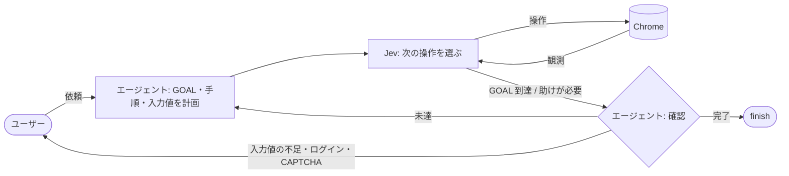

# webhand

[English](README.md) | 日本語

**人がサービスに慣れるように、サービスを学んでから操作するブラウザエージェントです。** Claude Code・Antigravity・Codex などのコーディングエージェント（Agent Skills 対応ツール）のプラグイン／スキルとして動き、予約や申し込み、フォームへの入力などを言葉で頼むと、学んだことをもとにブラウザを操作して片付けます。

```text
/webhand HOTEL PLANISPHERE で来月の土曜から2泊、2名で予約して
```

- **サービスを学ぶ。** 人の操作の記録やサービスのソースコードから、ページの構成、手順、注意点を学び、サービス情報と手順書にまとめます。
- **学んだことをもとに操作する。** コーディングエージェントが学んだ内容から GOAL、手順、入力値を計画し、Jev がサービス情報と計画をもとにクリックと入力を選びます。届かなければ、エージェントが原因を考えて計画を見直します。
- **学ぶ前から使える。** 初めてのサイトでも、頼んだ内容から計画して操作します。よく使うサービスから学ばせていけます。

> ⚠️ **webhand が操作するページの内容は Jev（TypeSafe の API）に送られます。** 保存プロファイルを使う場合は、ログインしたページも含みます。[安全とプライバシー](#安全とプライバシー)を参照してください。

## はじめに

1. 使っているコーディングエージェントにプラグインまたはスキルを追加します。

   - **Claude Code**:

     ```text
     /plugin marketplace add sakamoto66/webhand
     /plugin install webhand@webhand
     ```

   - **Antigravity (`agy`)**:

     ```bash
     agy plugin install https://github.com/sakamoto66/webhand
     ```

   - **OpenAI Codex CLI**:

     ```bash
     codex plugin marketplace add sakamoto66/webhand
     ```

     続けて Codex 内で `/plugins` を開き、`webhand` をインストールします。

   - **その他の Agent Skills 対応エージェント**: `skills/webhand*` を各エージェントのスキルディレクトリ（`.agents/skills/` など）に配置します。

2. Jev の API キーを環境変数に設定し、コーディングエージェントを起動し直します（`TYPESAFE_MODEL` で使うモデルも変えられます）。

   ```bash
   echo 'export TYPESAFE_API_KEY=...' >> ~/.bashrc   # 使っているシェルの設定ファイルに
   ```

3. 用事を頼みます（Claude Code では `/webhand`、Antigravity や Codex では `webhand` スキルを指定して依頼します）。

   ```text
   /webhand HOTEL PLANISPHERE で来月の土曜から2泊、2名で予約して
   ```

必要なもの: Node.js 22 以上と Google Chrome（Linux、または WSL から Windows 側。[WSL で Windows 側の Chrome を使う](docs/reference.ja.md#wsl-で-windows-側の-chrome-を使う)を参照）。CLI はインストール不要で、スキルが `npx -y webhand@0.5 ...` で実行します。毎回の起動を速くしたい場合は `npm i -g webhand` で入れておくと、スキルは `webhand ...` を使います。

```bash
npx -y webhand@0.5 catalog   # 動作確認
```

## しくみ



1. **学習する**: `webhand-learn`（`/webhand-learn`）で、人の操作の記録、ソースコード、または過去の実行ログから、サービス情報と手順書を作ります。
2. **頼む**: `/webhand ホテルを予約して` のように投稿します。コーディングエージェントが学習済みのデータから GOAL、手順、入力値を計画し、足りない情報はユーザーに質問します。
3. **セッションを選ぶ**: 新規（使い捨て、既定）か、ログイン状態を残した保存プロファイルかを選びます。
4. **実行する**: 計画した URL を開きます。Jev は、サービス情報、計画、表示中のページ、これまでの操作履歴をもとに次の操作を選び、GOAL までループします。
5. **見直す**: GOAL に届かなければ、エージェントが原因を書いて計画を見直し、再挑戦します（既定で最大3回）。

変更せずにデータを読み取りたいときは `webhand-extract`（`/webhand-extract`）を使います。Jev はページまで進めるだけで、値は `webhand extract` が表・一覧・リンクからそのまま読みます（`--read-only` のセッション、件数と読めなかった部分つき）。

用事を済ませるのではなくテスト環境で不具合を探すときは `webhand-explore`（`/webhand-explore`）を使います。エージェントが方針（チャーター）を決め、Jev が操作し、webhand がコンソールエラー、5xx、行き止まりを記録して、許可したホスト以外へのアクセスを拒否します。結果は判定ではなく、再現手順つきの候補です。

受け入れ条件を確認したいときは `webhand-verify`（`/webhand-verify`）を使います。Jev は操作だけを行い、エージェントが画面を読んで条件ごとに `PASS`・`FAIL`・`INCONCLUSIVE` を証拠つきで判定します。保存した受け入れ確認を繰り返し実行してリグレッションを検知するときは `webhand-regress`（`/webhand-regress`）を使います。

判断（計画、入力値、確認、見直し）はコーディングエージェントが、クリックと入力の繰り返しは Jev が担います。Jev は、ページで見つけた要素とエージェントが書いた入力値の中から選ぶだけです。エージェントに制御が戻るのは、Jev が GOAL 到達を報告したとき、入力値や人の操作が必要なとき、行き詰まったとき、操作が効いたか分からないときだけです。一覧は[役割分担](docs/reference.ja.md#役割分担)にあります。

## エンジン

`--engine` で、ブラウザを動かすものを選びます。既定の `auto` は、窓も保存プロファイルも要らない実行で、headless shell が入っていればそれを使い、そうでなければ Chrome を使います。

| | Chrome | headless shell | Obscura | Lightpanda | Browser Run | Kitesurf |
| --- | --- | --- | --- | --- | --- | --- |
| 窓（`--headed`）、`[person]` ステップ、`learn`、保存プロファイル | 使える | 使えない | 使えない | 使えない | 使えない | 使えない |
| 1 ページのメモリ | 約 350〜470 MB（`--headless=new`） | 約 240〜260 MB | 約 23〜33 MB | 約 23〜33 MB | 手元では使わない（Cloudflare 上で動く） | 手元では使わない（Cloudflare 上で動く） |
| 実際のレイアウトとスクリーンショット | ある | ある | ある | ない（疑似） | ある（Chromium） | スクリーンショットは撮れる。ピクセル単位では一致しない（Cloudflare 独自のブラウザ） |
| 複数タブ | 使える | 使える | 実際には 1 つ（新しいウィンドウは開かないか、同じタブで開く） | 使えない | 使える | 不安定（新しいウィンドウを開くリンクを押すと、数秒後にセッションが終わることがある。3 回中 2 回。新しいタブへの切り替えが通ったのは 1 回） |
| コマンドの間でページが残る | 残る | 残る | 小さな常駐プロセスで保つ | 小さな常駐プロセスで保つ | セッションの間は残る（無操作の上限 20 分） | 無操作の上限 60 秒 |
| 保存したログイン（`--auth`） | 使える | 使える | 使える | 使える | 使える | 使える |

窓と保存プロファイルが使えるのは Chrome だけです。Obscura と Lightpanda はずっと軽いものの、ページの読み取りが Chrome と違うことがあるので、頼る前に Chrome と結果を比べてください。`--engine browser-run` と `--engine kitesurf` は別で、ブラウザを Cloudflare 上で動かします（[Browser Run](docs/reference.ja.md#browser-run)）。手元では何も動きませんが、実行で開いたページは Cloudflare に送られます。Kitesurf は Cloudflare 独自のステートレスなエージェント向けブラウザ（ベータ。Chromium ではない）で、コマンドが 60 秒来ないとセッションが閉じます。詳しい制限は、[ヘッドレスシェル](docs/reference.ja.md#ヘッドレスシェル)、[Lightpanda](docs/reference.ja.md#lightpanda)、[Obscura](docs/reference.ja.md#obscura)、[保存したログイン](docs/reference.ja.md#保存したログインauth) を見てください。

## 安全とプライバシー

- **外部に送られるもの**: 操作中のページの文字と操作対象、ほかの開いているタブのタイトルは Jev（TypeSafe の API）に送られます。保存プロファイルを使う場合は、ログインしたページも含みます。実行のたびに、送ってよい画面か判断してください。
- **プロファイル**: 既定では使い捨てのプロファイルを使い、実行が終わると削除します。ログイン状態は webhand 専用の保存プロファイル（`--session profile:NAME`）にだけ残し、実行ごとにユーザーが選びます。普段使いの Chrome プロファイルには接続しません。
- **資格情報**: パスワードや確認コードは、ユーザーが Chrome に直接入力します。コーディングエージェントは受け取らず、webhand は password 欄の値を読みません。
- **推測で入力しない**: 入力されるのは、エージェントが計画で書いた値と、あなたが渡した値だけです。足りなければ尋ねます。
- **やみくもに再試行しない**: ページへの変更操作はリトライしません。操作が効いたか分からないときは、繰り返さずに停止します。
- **ページの本文は信頼しない**: ページの内容はデータとして扱い、指示としては扱いません。
- **記録とログ**: 学習モードでは、パスワード、ワンタイムコード、カード番号などの欄と、URL のクエリ値をすべて伏せます。実行ログには、入力した値ではなく値のラベルを残します。`WEBHAND_SCREENSHOTS=1` のときだけ保存するスクリーンショットには、入力した値も写ります。`~/.webhand/runs/` のログとスクリーンショットにはページの文字が残るため、共有しないでください。
- **サイトについて覚えること**: 既定の流れ（v2）は、試したクリックや選択と、ページが変わったかどうかを、ページの種類ごとにあなたのマシンの `~/.webhand/knowledge/` に記録し、`done` で終わった実行の分をあとの実行で Jev に示します。入力した文、値、個人情報、リスト項目の中のラベルは記録しません。`WEBHAND_KNOWLEDGE=0` で止め（`WEBHAND_KNOWLEDGE_USE=0` は提示だけを止めます）、`webhand knowledge clear` で消せます。
- **使う前に確認**: 手順書は `draft` で作られ、ユーザーが `approved` にするまで通常の実行には使いません。秘密情報や個人情報は手順書に書かず、`params` で渡します。

## ドキュメント

| 文書 | 内容 |
| --- | --- |
| [リファレンス](docs/reference.ja.md) | 保存場所、役割分担と結果、セッション、コマンド、学習モード、ページの領域、ログ |
| [利用ガイド](docs/usage.ja.md) | スキルと CLI の使い方、よくあるつまずき |
| [DEVELOPMENT.ja.md](DEVELOPMENT.ja.md) | 開発に参加する人向け。コード構成、規則、テスト、研究、リリース手順 |

## ライセンス

MIT License（`LICENSE`）。

`assets/snapshot.js`、`src/policies/base.ts`、`src/policies/jev.ts`、`tasks/fixtures/hotel.html` は [jev-ultrafast](https://github.com/browser-use/jev-ultrafast)（MIT）を改変したものです。`THIRD_PARTY_LICENSE_jev-ultrafast.txt` を参照してください。
