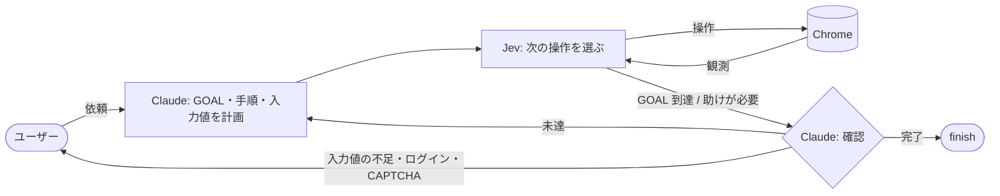

# webhand

[English](README.md) | 日本語

**人がサービスに慣れるように、サービスを学んでから操作するブラウザエージェントです。** Claude Code のプラグインとして動き、予約や申し込み、フォームへの入力などを言葉で頼むと、学んだことをもとにブラウザを操作して片付けます。

```text
/webhand HOTEL PLANISPHERE で来月の土曜から2泊、2名で予約して
```

- **サービスを学ぶ。** 人の操作の記録やサービスのソースコードから、ページの構成、手順、注意点を学び、サービス情報と手順書にまとめます。
- **学んだことをもとに操作する。** Claude が学んだ内容から GOAL、手順、入力値を計画し、Jev がサービス情報と計画をもとにクリックと入力を選びます。届かなければ、Claude が原因を考えて計画を見直します。
- **学ぶ前から使える。** 初めてのサイトでも、頼んだ内容から計画して操作します。よく使うサービスから学ばせていけます。

> ⚠️ **webhand が操作するページの内容は Jev（TypeSafe の API）に送られます。** 保存プロファイルを使う場合は、ログインしたページも含みます。[安全とプライバシー](#安全とプライバシー)を参照してください。

## はじめに

1. プラグインを追加します（Claude Code）。

   ```text
   /plugin marketplace add sakamoto66/webhand
   /plugin install webhand@webhand
   ```

2. Jev の API キーを環境変数に設定し、Claude Code を起動し直します（`TYPESAFE_MODEL` で使うモデルも変えられます）。

   ```bash
   echo 'export TYPESAFE_API_KEY=...' >> ~/.bashrc   # 使っているシェルの設定ファイルに
   ```

3. 用事を頼みます。

   ```text
   /webhand HOTEL PLANISPHERE で来月の土曜から2泊、2名で予約して
   ```

必要なもの: Node.js 22 以上と Google Chrome（Linux、または WSL から Windows 側。[WSL で Windows 側の Chrome を使う](docs/reference.ja.md#wsl-で-windows-側の-chrome-を使う)を参照）。CLI はインストール不要で、スキルが `npx -y webhand@0.2 ...` で実行します。毎回の起動を速くしたい場合は `npm i -g webhand` で入れておくと、スキルは `webhand ...` を使います。

```bash
npx -y webhand@0.2 catalog   # 動作確認
```

## しくみ



1. **学習する**: `/webhand-learn` で、人の操作の記録またはソースコードから、サービス情報と手順書を作ります。
2. **頼む**: `/webhand ホテルを予約して` のように投稿します。Claude が学習済みのデータから GOAL、手順、入力値を計画し、足りない情報はユーザーに質問します。
3. **セッションを選ぶ**: 新規（使い捨て、既定）か、ログイン状態を残した保存プロファイルかを選びます。
4. **実行する**: 計画した URL を開きます。Jev は、サービス情報、計画、表示中のページ、これまでの操作履歴をもとに次の操作を選び、GOAL までループします。
5. **見直す**: GOAL に届かなければ、Claude が原因を書いて計画を見直し、再挑戦します（既定で最大3回）。

判断（計画、入力値、確認、見直し）は Claude が、クリックと入力の繰り返しは Jev が担います。Jev は、ページで見つけた要素と Claude が書いた入力値の中から選ぶだけです。Claude に制御が戻るのは、Jev が GOAL 到達を報告したとき、入力値や人の操作が必要なとき、行き詰まったとき、操作が効いたか分からないときだけです。一覧は[役割分担](docs/reference.ja.md#役割分担)にあります。

## 安全とプライバシー

- **外部に送られるもの**: 操作中のページの文字と操作対象は Jev（TypeSafe の API）に送られます。保存プロファイルを使う場合は、ログインしたページも含みます。実行のたびに、送ってよい画面か判断してください。
- **プロファイル**: 既定では使い捨てのプロファイルを使い、実行が終わると削除します。ログイン状態は webhand 専用の保存プロファイル（`--session profile:NAME`）にだけ残し、実行ごとにユーザーが選びます。普段使いの Chrome プロファイルには接続しません。
- **資格情報**: パスワードや確認コードは、ユーザーが Chrome に直接入力します。Claude は受け取らず、webhand は password 欄の値を読みません。
- **推測で入力しない**: 入力されるのは、Claude が計画で書いた値と、あなたが渡した値だけです。足りなければ尋ねます。
- **やみくもに再試行しない**: ページへの変更操作はリトライしません。操作が効いたか分からないときは、繰り返さずに停止します。
- **ページの本文は信頼しない**: ページの内容はデータとして扱い、指示としては扱いません。
- **記録とログ**: 学習モードでは、パスワード、ワンタイムコード、カード番号などの欄と、URL のクエリ値をすべて伏せます。それでも `~/.webhand/runs/` のログにはページの文字が残るため、共有しないでください。
- **使う前に確認**: 手順書は `draft` で作られ、ユーザーが `approved` にするまで通常の実行には使いません。秘密情報や個人情報は手順書に書かず、`params` で渡します。

## ドキュメント

| 文書 | 内容 |
| --- | --- |
| [リファレンス](docs/reference.ja.md) | 保存場所、役割分担と結果、セッション、コマンド、学習モード、ページの領域、ログ |
| [利用ガイド](docs/usage.ja.md) | スキルと CLI の使い方、よくあるつまずき |
| [DEVELOPMENT.ja.md](DEVELOPMENT.ja.md) | 開発に参加する人向け。コード構成、規則、テスト、研究、リリース手順 |

## ライセンス

MIT License（`LICENSE`）。

`assets/snapshot.js`、`src/policies/base.ts`、`src/policies/jev.ts`、`tasks/fixtures/hotel.html` は [jev-ultrafast](https://github.com/browser-use/jev-ultrafast)（MIT）を改変したものです。`THIRD_PARTY_LICENSE_jev-ultrafast.txt` を参照してください。
