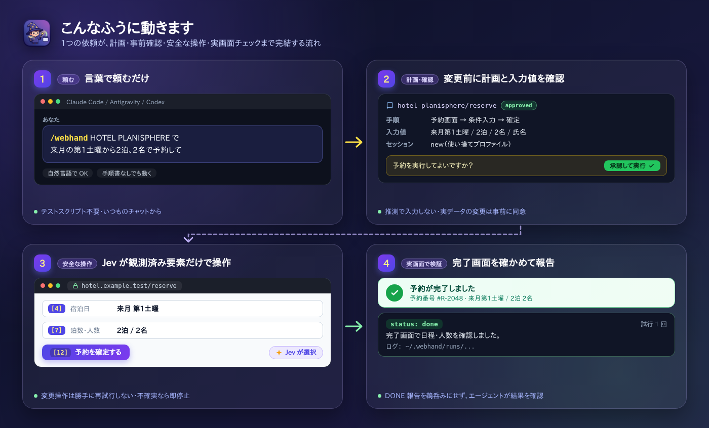

<div align="center">
  
  <h1>webhand</h1>
  <p><strong>コーディングエージェントに話しかけるだけで、あなたの代わりに Web 上の作業・確認・情報収集を安全に片付けるツール。</strong></p>
  <p>
    <a href="README.md">English</a> | 日本語
  </p>
  <p>
    <a href="https://www.npmjs.com/package/webhand"></a>
    <a href="LICENSE"></a>
    = 22" />
  </p>
</div>

**webhand** は、**Claude Code**・**Antigravity**・**OpenAI Codex CLI** などのコーディングエージェント（Agent Skills 対応ツール）で動くプラグイン／スキル群です。予約やフォーム入力、一覧データの取得、リリース前の受け入れ確認まで、普段ブラウザで行っている作業を言葉で頼むだけで、エージェントが計画・確認し、**Jev** がサービス情報・手順書・過去の経験をもとにブラウザを操作して片付けます。

> [!NOTE]
> **外部に送られる情報について:** webhand が操作するページの本文・操作対象（および他に開いているタブのタイトル）は **Jev（TypeSafe の API）** に送られます。保存プロファイルや `--auth` を使う場合は、ログイン済みのページも含みます。詳しくは[安全とプライバシー](#安全とプライバシー)を確認してください。

---

## こんなふうに動きます

いつものコーディングエージェントの画面から、自然な言葉で頼むだけです（テストスクリプトを書く必要はありません）：



<!-- デモ GIF 枠: 録画後に docs/media/demo.gif を追加・差し替え -->

---

## 頼める 6 つの仕事

webhand は目的に合わせた **6 つのスキル** を備えており、仕事ごとに適切な安全設計と成果物の形式で返します：

| 頼みたい仕事 | スキル | 返ってくる成果物 | 頼み方の例 |
| --- | --- | --- | --- |
| **作業を済ませる** | `/webhand` | 予約・申請・管理画面入力などの実行結果と、確認済みの最終画面 | `/webhand HOTEL PLANISPHERE で来月の土曜から2泊、2名で予約して` |
| **データを安全に集める** | `/webhand-extract` | ページ原文そのままの表・一覧・リンク（`--read-only`、件数と読めなかった部分つき） | `/webhand-extract https://example.test/plans から全プランのプラン名と月額を取って` |
| **受け入れ条件を確かめる** | `/webhand-verify` | 条件ごとの `PASS` / `FAIL` / `INCONCLUSIVE` 判定と画面文言の引用証拠 | `/webhand-verify https://staging.example.com で次を確認して: 価格の昇順で並ぶ / 合計に税が含まれる` |
| **壊れていないか見直す** | `/webhand-regress` | 保存した確認の固定期待値による再実行結果（`NEW FAIL` / `STILL FAILING` / `RECOVERED`） | `/webhand-regress shop/checkout` |
| **テスト環境で不具合を探す** | `/webhand-explore` | 再現手順つきの異常候補（コンソールエラー・5xx・行き止まり）。許可ホスト外は遮断 | `/webhand-explore http://localhost:3000 の決済フォームに異常な入力を試して（許可ホスト: localhost:3000）` |
| **サービスの使い方を教える** | `/webhand-teach` | 人の操作の記録・ソースコード・過去ログから作るサービス情報と手順書（`draft` -> 承認） | `/webhand-teach --name myservice/search --url https://example.com` |

---

## なぜ webhand なのか

- **「頭脳」と「手」を分けて確実に動かす。** GOAL の計画、入力値の決定、最終確認、計画の見直しはコーディングエージェントが担い、**Jev** は観測済みの要素番号とエージェントが明示した入力値から選ぶだけ。勝手なセレクタ・座標・コード・推測文は出力させません。
- **実務の作業を任せられる安全ガードレール。** 変更操作はやみくもに再試行せず、結果が不確かなら即停止します。パスワード・2FA・CAPTCHA はユーザーが Chrome に直接入力し、エージェントには渡しません。普段使いの Chrome プロファイルにも一切接続しません。
- **使い方を覚えて、チームで資産化できる。** 一度教えたサービス情報と手順書は `.webhand/runbooks/`（プロジェクトで Git 共有）や `~/.webhand/runbooks/`（個人用）に保存されます。下書き（`draft`）はユーザーが承認（`approved`）するまで通常実行に使いません。
- **初めてのサイトでもそのまま使える。** 手順書がないサイトでも依頼内容から計画して操作し、よく使うサービスから少しずつ覚えさせていけます。

### 得意なこと・あえてやらないこと

| 得意なこと | あえてやらないこと（設計外） |
| --- | --- |
| 人が見守りながら任せる単発〜準定型の Web 作業（予約・申請・社内ツール） | 大量スクレイピングや、完全無人の CI / cron 定期実行 |
| 自然言語の受け入れ条件を画面引用つきで確かめる QA 作業 | 高速・決定的な Playwright テストの置き換え |
| 変更操作を遮断した読み取り専用のデータ抽出（表・一覧・リンク） | Canvas・WebGL・ドラッグ操作など座標前提の UI |
| ステージング／ローカル環境での探索的な不具合チェック | CAPTCHA やボット対策の回避 |

---

## クイックスタート

### 前提条件

- **Node.js 22** 以上
- **Google Chrome**（Linux、または WSL から Windows 側。[WSL で Windows 側の Chrome を使う](docs/reference.ja.md#wsl-で-windows-側の-chrome-を使う)を参照）
- Jev（TypeSafe の API）の環境変数 **`TYPESAFE_API_KEY`**

### 1. コーディングエージェントにプラグインまたはスキルを入れる

- **Claude Code**:

  ```text
  /plugin marketplace add sakamoto66/webhand
  /plugin install webhand@webhand
  ```

- **Antigravity (`agy`)**:

  ```bash
  agy plugin install https://github.com/sakamoto66/webhand
  ```

- **OpenAI Codex CLI**:

  ```bash
  codex plugin marketplace add sakamoto66/webhand
  ```

  続けて Codex 内で `/plugins` を開き、`webhand` をインストールします。

- **その他の Agent Skills 対応エージェント**: `skills/webhand*` を各エージェントのスキルディレクトリ（`.agents/skills/` など）に配置します。

### 2. `TYPESAFE_API_KEY` を設定してエージェントを再起動する

```bash
echo 'export TYPESAFE_API_KEY=...' >> ~/.bashrc   # 使っているシェルの設定ファイルに（~/.zshrc など）
# 使うモデルを変える場合: export TYPESAFE_MODEL=...
```

> [!TIP]
> CLI 本体のインストールは不要です（スキルが `npx -y webhand@0.5 ...` を自動実行します）。毎回の起動を速くしたい場合は `npm i -g webhand` でグローバル導入しておくと、スキルが `webhand` を直接使います。

### 3. 動作確認して、最初の用事を頼んでみる

```bash
npx -y webhand@0.5 catalog   # CLI の動作確認と、登録済みサービス・手順書の一覧表示
```

あとはコーディングエージェントから頼むだけです（Claude Code では `/webhand`、Antigravity や Codex では `webhand` スキルを指定して依頼します）：

```text
/webhand HOTEL PLANISPHERE で来月の土曜から2泊、2名で予約して
```

---

## しくみ


1. **使い方を教える（任意）**: `/webhand-teach` で、人の操作の記録・ソースコード・過去の実行ログからサービス情報と下書き手順書を作ります。確認して承認すると通常実行で使えます。
2. **頼んで計画する**: 言葉で依頼すると、コーディングエージェントが覚えたサービス情報と手順書から GOAL・手順・入力値を計画します。足りない情報は質問し、実データを変える作業の前には同意を取ります。
3. **セッションを選ぶ**: 既定は使い捨ての新規プロファイルです。ログイン状態を保ちたいときだけ、webhand 専用の保存プロファイル（`profile:NAME`）を選びます。
4. **実行する**: 計画した URL を開き、Jev が計画・サービス情報・現在の画面・過去の操作経験をもとに GOAL までクリックと入力を進めます。
5. **確認と見直し**: 制御がコーディングエージェントに戻り、実際の画面を見て確認します。届かなければ原因を書いて計画を見直し、再挑戦します（既定で最大 3 回）。

制御がエージェントに戻る条件の一覧は[役割分担](docs/reference.ja.md#役割分担)を参照してください。

---

## 安全とプライバシー

- **外部に送られるもの**: 操作中のページの文字と操作対象、ほかの開いているタブのタイトルは Jev（TypeSafe の API）に送られます。保存プロファイルや `--auth` を使う場合は、ログインしたページも含みます。実行のたびに、送ってよい画面か判断してください。
- **プロファイルの分離**: 既定では使い捨てのプロファイルを使い、実行が終わると削除します。ログイン状態は webhand 専用の保存プロファイル（`--session profile:NAME`）にだけ残し、実行ごとにユーザーが選びます。普段使いの Chrome プロファイルには接続しません。
- **資格情報は人が直接入力**: パスワードや確認コード、CAPTCHA はユーザーが Chrome に直接入力します。コーディングエージェントは受け取らず、webhand は password 欄の値を読みません。
- **推測で入力しない**: 入力されるのは、エージェントが計画で書いた値と、あなたが渡した値だけです。足りなければ尋ねます。
- **やみくもに再試行しない**: ページへの変更操作はリトライしません。操作が効いたか分からないときは、繰り返さずに停止（`UNCERTAIN`）します。
- **ページの本文は信頼しない**: ページの内容はデータとして扱い、指示としては扱いません。
- **記録とログ**: モデルの再学習や重みの更新は行いません。覚える内容はすべて手元のファイル（手順書やサイトの記憶）として保存します。操作の記録（`webhand record`）では、パスワード、ワンタイムコード、カード番号などの欄と URL のクエリ値をすべて伏せます。実行ログには入力した値ではなく値のラベルを残します。`WEBHAND_SCREENSHOTS=1` のときだけ保存するスクリーンショットには入力した値も写ります。`~/.webhand/runs/` のログとスクリーンショットにはページの文字が残るため、共有しないでください。
- **操作の経験（サイトの記憶）**: 既定の流れ（v2）は、試したクリックや選択とページが変わったかどうかを、ページの種類ごとにあなたのマシンの `~/.webhand/memory/` に記憶し、`done` で終わった実行の分をあとの実行で Jev に示します（旧 `~/.webhand/knowledge/` がある場合は自動で引き継ぎます）。入力した文、値、個人情報、リスト項目の中のラベルは記録しません。`WEBHAND_MEMORY=0` で止め（`WEBHAND_MEMORY_USE=0` は提示だけを止めます）、`webhand memory clear` で消せます。
- **使う前に確認**: 手順書は `draft` で作られ、ユーザーが `approved` にするまで通常の実行には使いません。秘密情報や個人情報は手順書に書かず、`params` で渡します。

---

## ブラウザエンジン

`--engine` でブラウザを動かすエンジンを選べます。既定の `auto` は、ウィンドウも保存プロファイルも要らない実行で headless shell が入っていればそれを使い、そうでなければ Google Chrome を使います。普段は変更不要です。

<details>
<summary>対応エンジンの詳細比較（Chrome / headless shell / Obscura / Lightpanda / Browser Run / Kitesurf）</summary>

| | Chrome | headless shell | Obscura | Lightpanda | Browser Run | Kitesurf |
| --- | --- | --- | --- | --- | --- | --- |
| 窓（`--headed`）、`[person]` ステップ、`record`、保存プロファイル | 使える | 使えない | 使えない | 使えない | 使えない | 使えない |
| 1 ページのメモリ | 約 350〜470 MB（`--headless=new`） | 約 240〜260 MB | 約 23〜33 MB | 約 23〜33 MB | 手元では使わない（Cloudflare 上で動く） | 手元では使わない（Cloudflare 上で動く） |
| 実際のレイアウトとスクリーンショット | ある | ある | ある | ない（疑似） | ある（Chromium） | スクリーンショットは撮れる。ピクセル単位では一致しない（Cloudflare 独自のブラウザ） |
| 複数タブ | 使える | 使える | 実際には 1 つ（新しいウィンドウは開かないか、同じタブで開く） | 使えない | 使える | 不安定（新しいウィンドウを開くリンクを押すと、数秒後にセッションが終わることがある。3 回中 2 回。新しいタブへの切り替えが通ったのは 1 回） |
| コマンドの間でページが残る | 残る | 残る | 小さな常駐プロセスで保つ | 小さな常駐プロセスで保つ | セッションの間は残る（無操作の上限 20 分） | 無操作の上限 60 秒 |
| 保存したログイン（`--auth`） | 使える | 使える | 使える | 使える | 使える | 使える |

窓と保存プロファイルが使えるのは Chrome だけです。Obscura と Lightpanda はずっと軽いものの、ページの読み取りが Chrome と違うことがあるので、頼る前に Chrome と結果を比べてください。`--engine browser-run` と `--engine kitesurf` はブラウザを Cloudflare 上で動かします（[Browser Run](docs/reference.ja.md#browser-run)）。手元では何も動きませんが、実行で開いたページは Cloudflare に送られます。Kitesurf は Cloudflare 独自のステートレスなエージェント向けブラウザ（ベータ。Chromium ではない）で、コマンドが 60 秒来ないとセッションが閉じます。詳しい制限は、[ヘッドレスシェル](docs/reference.ja.md#ヘッドレスシェル)、[Lightpanda](docs/reference.ja.md#lightpanda)、[Obscura](docs/reference.ja.md#obscura)、[保存したログイン](docs/reference.ja.md#保存したログインauth) を見てください。

</details>

---

## ドキュメント

| 文書 | 内容 |
| --- | --- |
| [利用ガイド](docs/usage.ja.md) | 6 つのスキルと CLI の使い方、よくあるつまずき |
| [リファレンス](docs/reference.ja.md) | 保存場所、役割分担と結果、セッション、コマンド、使い方を教える（記録と手順書）、ページの領域、ログ |
| [DEVELOPMENT.ja.md](DEVELOPMENT.ja.md) | 開発に参加する人向け。コード構成、規則、テスト、研究、リリース手順 |

---

## コントリビューション

Issue や Pull Request を歓迎します！コード構成、安全・実験の規則、チェックの実行方法（`npm run check`、`npm test`）については [DEVELOPMENT.ja.md](DEVELOPMENT.ja.md) をご覧ください。

---

## ライセンス・謝辞

MIT License（[LICENSE](LICENSE)）。

`assets/snapshot/`、`src/policies/base.ts`、`src/policies/jev.ts`、`tasks/fixtures/hotel.html` は [jev-ultrafast](https://github.com/browser-use/jev-ultrafast)（MIT）を改変したものです。[THIRD_PARTY_LICENSE_jev-ultrafast.txt](THIRD_PARTY_LICENSE_jev-ultrafast.txt) を参照してください。
