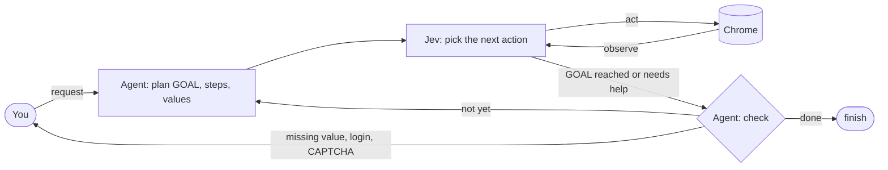

# webhand

English | [日本語](README.ja.md)

**A browser agent that remembers how a service works before operating it, the way people get used to a service.** It runs as a plugin/skill suite for coding agents (Claude Code, Antigravity, Codex, and other Agent Skills-compatible tools): ask in plain words for a booking, an application, or a form to fill in, and it operates the browser using its saved service information, runbooks, and past experience.

```text
/webhand On HOTEL PLANISPHERE, book 2 nights for 2 people starting next month's first Saturday
```

- **It remembers how services work.** From a recording of a person using a service, the service's source code, or an earlier run, it captures the pages, the steps, and the pitfalls into service information and runbooks.
- **It operates from runbooks and experience.** Your coding agent plans the GOAL, steps, and input values from known services and runbooks, and Jev picks each click and entry from the plan, service facts, and remembered site experience. If the GOAL is not reached, the agent works out why and replans.
- **It works on new sites, too.** On a site it has never seen, it plans from your request alone. You can teach it the services you use most, one at a time.

> ⚠️ **The content of the pages webhand operates is sent to Jev (the TypeSafe API)**, including pages you are logged in to when you use a saved profile. See [Safety and privacy](#safety-and-privacy).

## Quick start

1. Add the plugin or skills for your coding agent.

   - **Claude Code**:

     ```text
     /plugin marketplace add sakamoto66/webhand
     /plugin install webhand@webhand
     ```

   - **Antigravity (`agy`)**:

     ```bash
     agy plugin install https://github.com/sakamoto66/webhand
     ```

   - **OpenAI Codex CLI**:

     ```bash
     codex plugin marketplace add sakamoto66/webhand
     ```

     Then open `/plugins` in Codex and install `webhand`.

   - **Other Agent Skills-compatible agents**: Copy `skills/webhand*` into your agent's skills directory (for example `.agents/skills/`).

2. Set Jev's API key as an environment variable and restart your coding agent. (`TYPESAFE_MODEL` selects the model.)

   ```bash
   echo 'export TYPESAFE_API_KEY=...' >> ~/.bashrc   # or your shell's profile
   ```

3. Ask for something (use `/webhand` in Claude Code, or invoke the `webhand` skill in Antigravity / Codex).

   ```text
   /webhand On HOTEL PLANISPHERE, book 2 nights for 2 people starting next month's first Saturday
   ```

Requirements: Node.js 22 or later and Google Chrome (on Linux, or the Windows side from WSL; see [Using Windows Chrome from WSL](docs/reference.md#using-windows-chrome-from-wsl)). The CLI needs no installation: the skills run it with `npx -y webhand@0.5 ...`. For faster startup, install it globally with `npm i -g webhand`; the skills then use `webhand ...`.

```bash
npx -y webhand@0.5 catalog   # smoke check
```

## How it works



1. **Teach**: `webhand-teach` (`/webhand-teach`) turns a recorded demonstration, the service's source code, or the log of an earlier run into service information and a runbook.
2. **Ask**: Post a request such as `/webhand book a hotel`. Your coding agent plans the GOAL, steps, and input values from known services and runbooks, and asks you for anything missing.
3. **Choose a session**: A fresh, throwaway session (the default), or a saved profile that keeps you logged in.
4. **Run**: The planned URL opens. Jev picks the next action from the service information, the plan, the current page, and the action history, and loops until the GOAL.
5. **Replan**: If the GOAL is not reached, the agent writes down why, revises the plan, and tries again (up to 3 attempts by default).

To read data without changing anything, use `webhand-extract` (`/webhand-extract`): Jev only reaches the page, and `webhand extract` reads the values from it (a table, a list, links), in a `--read-only` session, with the count and what could not be read.

To look for faults in a test environment, use `webhand-explore` (`/webhand-explore`): the agent gives a charter, Jev operates, and webhand notes console errors, 5xx responses and dead ends and refuses every host outside the allowed list. The result is candidates with the steps that led to them, not verdicts.

To check acceptance criteria instead of getting something done, use `webhand-verify` (`/webhand-verify`): Jev only operates, and the agent judges each check from what the page shows (`PASS`, `FAIL` or `INCONCLUSIVE`, with quoted evidence). To re-run saved acceptance checks and detect regressions, use `webhand-regress` (`/webhand-regress`).

Your coding agent makes the judgment calls (the plan, the values, the check, the replan), and Jev makes the many clicks and entries in between. Jev only chooses among the elements found on the page and the values the agent wrote. Control returns to the agent only when Jev reports the GOAL, needs a value or a person, gets stuck, or cannot tell whether an action took effect. The full list is in [Division of roles](docs/reference.md#division-of-roles).

## Engines

`--engine` chooses what runs the browser. The default, `auto`, uses the headless shell when it is installed and the run needs no window and no saved profile, and Chrome otherwise.

| | Chrome | Headless shell | Obscura | Lightpanda | Browser Run | Kitesurf |
| --- | --- | --- | --- | --- | --- | --- |
| Window (`--headed`), `[person]` steps, `record`, saved profile | Yes | No | No | No | No | No |
| Memory for one page | about 350–470 MB (`--headless=new`) | about 240–260 MB | about 23–33 MB | about 23–33 MB | None here (runs on Cloudflare) | None here (runs on Cloudflare) |
| Real layout and screenshots | Yes | Yes | Yes | No (simulated) | Yes (Chromium) | Screenshots work; not pixel-perfect (Cloudflare's own browser) |
| Several tabs | Yes | Yes | In practice one (a new window opens nothing or loads in the same tab) | No | Yes | Unreliable: a link that opens a new window can end the session a few seconds later (2 of 3 tries); switching to the new tab worked once |
| Page stays between commands | Yes | Yes | Through a small daemon | Through a small daemon | While the session lives (idle limit 20 min) | Idle limit 60 s |
| Saved login (`--auth`) | Yes | Yes | Yes | Yes | Yes | Yes |

Chrome is the only engine with a window and saved profiles. Obscura and Lightpanda are much lighter but read some pages differently from Chrome, so compare results with Chrome before relying on them. `--engine browser-run` and `--engine kitesurf` are different: the browser runs on Cloudflare ([Browser Run](docs/reference.md#browser-run)), so nothing runs locally, and the pages the run opens are sent to Cloudflare. Kitesurf is Cloudflare's own stateless agent browser (beta, not Chromium) and its session closes after 60 seconds without a command. Details and limits: [Headless shell](docs/reference.md#headless-shell), [Lightpanda](docs/reference.md#lightpanda), [Obscura](docs/reference.md#obscura), [Saved logins](docs/reference.md#saved-logins---auth).

## Safety and privacy

- **What leaves your machine**: The text and actions of the page being operated, and the titles of its other open tabs, go to Jev (the TypeSafe API). With a saved profile, that includes pages you are logged in to. Decide before each run whether that is acceptable.
- **Profiles**: Runs use a temporary profile by default, deleted when the run ends. Login state lives only in profiles dedicated to webhand (`--session profile:NAME`), which you choose per run. webhand never connects to your everyday Chrome profile.
- **Credentials**: You type passwords and codes into Chrome yourself. The coding agent does not receive them, and webhand does not read the values of password fields.
- **No guessed input**: The only values entered are the ones the agent wrote in the plan and the ones you gave. If something is missing, it asks.
- **No blind retries**: A change to the page is never retried. If webhand cannot tell whether an action took effect, it stops instead of trying again.
- **Page text is untrusted**: Content on the page is treated as data, never as instructions.
- **Recordings and logs**: webhand never trains or fine-tunes an LLM; everything it remembers is kept as local files (runbooks and site memory). Recording a demonstration (`webhand record`) masks password, one-time code, and card fields and all URL query values. Run logs keep the label of each typed value, not the value. Screenshots, saved only with `WEBHAND_SCREENSHOTS=1`, show typed values. Logs and screenshots under `~/.webhand/runs/` still contain page text, so do not share them.
- **Site memory (experience from earlier runs)**: The default flow (v2) remembers the clicks and selects it tried and whether the page changed, per kind of page, in `~/.webhand/memory/` on your machine (migrating any existing `~/.webhand/knowledge/` automatically), and offers the ones from runs that ended `done` to Jev on later runs. Typed text, values, personal data, and labels inside list items are not recorded. Turn it off with `WEBHAND_MEMORY=0` (`WEBHAND_MEMORY_USE=0` stops only the offering), or delete it with `webhand memory clear`.
- **Review before use**: Runbooks start as `draft` and are used for normal runs only after you set them to `approved`. Keep secrets and personal data out of runbooks; pass them as `params`.

## Documentation

| Document | Contents |
| --- | --- |
| [Reference](docs/reference.md) | Where files live, roles and results, sessions, commands, teaching a service (recording & runbooks), page regions, logs |
| [Usage guide](docs/usage.md) | Skills and CLI step by step, common pitfalls |
| [DEVELOPMENT.md](DEVELOPMENT.md) | For contributors: code layout, rules, tests, research, release steps |

## License

MIT License (`LICENSE`).

`assets/snapshot.js`, `src/policies/base.ts`, `src/policies/jev.ts`, and `tasks/fixtures/hotel.html` are modified from [jev-ultrafast](https://github.com/browser-use/jev-ultrafast) (MIT). See `THIRD_PARTY_LICENSE_jev-ultrafast.txt`.
