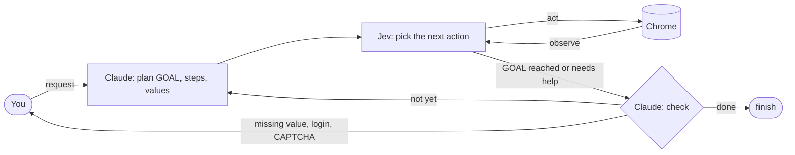

# webhand

English | [日本語](README.ja.md)

**A browser agent that learns a service before operating it, the way people get used to a service.** It runs as a Claude Code plugin: ask in plain words for a booking, an application, or a form to fill in, and it operates the browser based on what it has learned.

```text
/webhand On HOTEL PLANISPHERE, book 2 nights for 2 people starting next month's first Saturday
```

- **It learns services.** From a recording of a person using a service, or from the service's source code, it learns the pages, the steps, and the pitfalls, and writes them down as service information and runbooks.
- **It operates from what it learned.** Claude plans the GOAL, steps, and input values from what was learned, and Jev picks each click and entry from the service information and the plan. If the GOAL is not reached, Claude works out why and replans.
- **It works before learning, too.** On a site it has never seen, it plans from your request alone. You can teach it the services you use most, one at a time.

> ⚠️ **The content of the pages webhand operates is sent to Jev (the TypeSafe API)**, including pages you are logged in to when you use a saved profile. See [Safety and privacy](#safety-and-privacy).

## Quick start

1. Add the plugin in Claude Code.

   ```text
   /plugin marketplace add sakamoto66/webhand
   /plugin install webhand@webhand
   ```

2. Set Jev's API key as an environment variable and restart Claude Code. (`TYPESAFE_MODEL` selects the model.)

   ```bash
   echo 'export TYPESAFE_API_KEY=...' >> ~/.bashrc   # or your shell's profile
   ```

3. Ask for something.

   ```text
   /webhand On HOTEL PLANISPHERE, book 2 nights for 2 people starting next month's first Saturday
   ```

Requirements: Node.js 22 or later and Google Chrome (on Linux, or the Windows side from WSL; see [Using Windows Chrome from WSL](docs/reference.md#using-windows-chrome-from-wsl)). The CLI needs no installation: the skills run it with `npx -y webhand@0.2 ...`. For faster startup, install it globally with `npm i -g webhand`; the skills then use `webhand ...`.

```bash
npx -y webhand@0.2 catalog   # smoke check
```

## How it works



1. **Learn**: `/webhand-learn` turns a recorded demonstration, or the service's source code, into service information and a runbook.
2. **Ask**: Post a request such as `/webhand book a hotel`. Claude plans the GOAL, steps, and input values from what webhand has learned, and asks you for anything missing.
3. **Choose a session**: A fresh, throwaway session (the default), or a saved profile that keeps you logged in.
4. **Run**: The planned URL opens. Jev picks the next action from the service information, the plan, the current page, and the action history, and loops until the GOAL.
5. **Replan**: If the GOAL is not reached, Claude writes down why, revises the plan, and tries again (up to 3 attempts by default).

Claude makes the judgment calls (the plan, the values, the check, the replan), and Jev makes the many clicks and entries in between. Jev only chooses among the elements found on the page and the values Claude wrote. Control returns to Claude only when Jev reports the GOAL, needs a value or a person, gets stuck, or cannot tell whether an action took effect. The full list is in [Division of roles](docs/reference.md#division-of-roles).

## Safety and privacy

- **What leaves your machine**: The text and actions of the page being operated go to Jev (the TypeSafe API). With a saved profile, that includes pages you are logged in to. Decide before each run whether that is acceptable.
- **Profiles**: Runs use a temporary profile by default, deleted when the run ends. Login state lives only in profiles dedicated to webhand (`--session profile:NAME`), which you choose per run. webhand never connects to your everyday Chrome profile.
- **Credentials**: You type passwords and codes into Chrome yourself. Claude does not receive them, and webhand does not read the values of password fields.
- **No guessed input**: The only values entered are the ones Claude wrote in the plan and the ones you gave. If something is missing, it asks.
- **No blind retries**: A change to the page is never retried. If webhand cannot tell whether an action took effect, it stops instead of trying again.
- **Page text is untrusted**: Content on the page is treated as data, never as instructions.
- **Recordings and logs**: Learning mode masks password, one-time code, and card fields and all URL query values. Logs under `~/.webhand/runs/` still contain page text, so do not share them.
- **Review before use**: Runbooks start as `draft` and are used for normal runs only after you set them to `approved`. Keep secrets and personal data out of runbooks; pass them as `params`.

## Documentation

| Document | Contents |
| --- | --- |
| [Reference](docs/reference.md) | Where files live, roles and results, sessions, commands, learning mode, page regions, logs |
| [Usage guide](docs/usage.ja.md) (Japanese) | Skills and CLI step by step, common pitfalls |
| [DEVELOPMENT.md](DEVELOPMENT.md) | For contributors: code layout, rules, tests, research, release steps |

## License

MIT License (`LICENSE`).

`assets/snapshot.js`, `src/policies/base.ts`, `src/policies/jev.ts`, and `tasks/fixtures/hotel.html` are modified from [jev-ultrafast](https://github.com/browser-use/jev-ultrafast) (MIT). See `THIRD_PARTY_LICENSE_jev-ultrafast.txt`.
