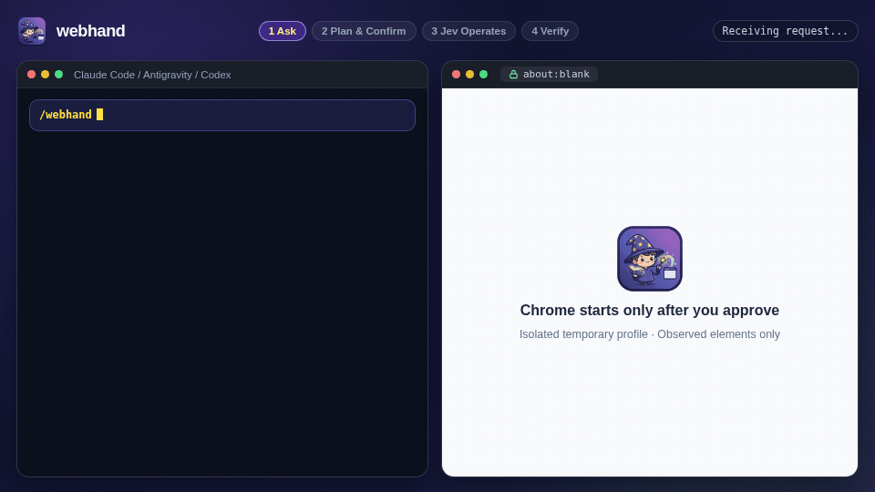
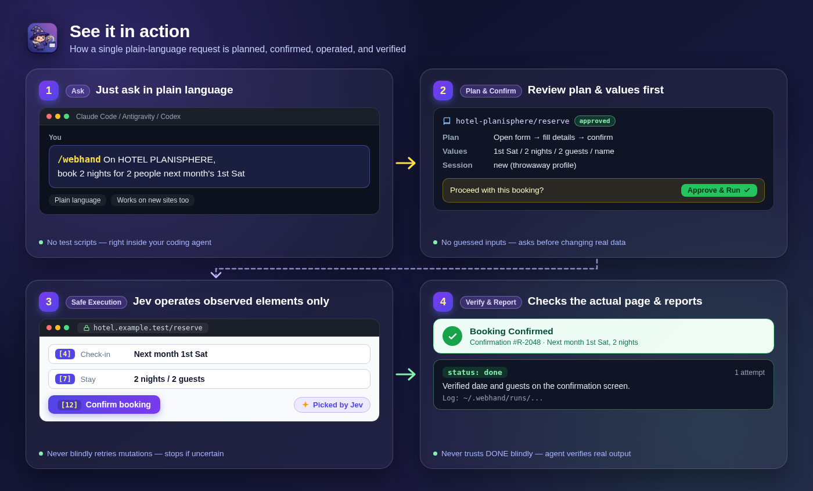

<div align="center">
  
  <h1>webhand</h1>
  <p><strong>Delegate everyday browser work to your coding agent — safely, verifiably, and with memory of how your services work.</strong></p>
  <p>
    English | <a href="README.ja.md">日本語</a>
  </p>
  <p>
    <a href="https://www.npmjs.com/package/webhand"></a>
    <a href="LICENSE"></a>
    = 22" />
  </p>
</div>

**webhand** is a plugin and skill suite for coding agents (**Claude Code**, **Antigravity**, **OpenAI Codex CLI**, and other Agent Skills-compatible tools). Instead of switching to your browser for repetitive forms, data collection, or pre-release QA checks, just ask in plain language — your coding agent plans, confirms, and verifies the result while **Jev** handles the clicks and entries.

> [!NOTE]
> **Data sent externally:** The text and interactive elements of pages operated by webhand (plus other open tab titles) are sent to **Jev (the TypeSafe API)**, including signed-in pages when using a saved profile or `--auth`. See [Safety and privacy](#safety-and-privacy).

---

## See it in action

Ask right from your coding agent session — no test script required:



<details>
<summary>View 4-step static breakdown</summary>



</details>

---

## What you can delegate

webhand provides **6 purpose-built skills** so every job has the right safety posture and output format:

| Job | Skill | What you get back | Example request |
| --- | --- | --- | --- |
| **Get things done** | `/webhand` | Completed booking, form submission, admin task, or CSV/JSON batch run with final-page verification | `/webhand On HOTEL PLANISPHERE, book 2 nights for 2 people starting next month's first Saturday` |
| **Extract data safely** | `/webhand-extract` | Clean tables, lists, or links read directly from the page (`--read-only`, with counts and gaps) | `/webhand-extract Read all plan names and monthly prices from https://example.test/plans` |
| **Check acceptance criteria** | `/webhand-verify` | Per-criterion `PASS` / `FAIL` / `INCONCLUSIVE` verdict with quoted on-page evidence | `/webhand-verify On https://staging.example.com, check: results sort by price ascending / total includes tax` |
| **Catch regressions** | `/webhand-regress` | Re-run saved checks against fixed expectations (`NEW FAIL`, `STILL FAILING`, `RECOVERED`) | `/webhand-regress shop/checkout` |
| **Hunt for bugs** | `/webhand-explore` | Reproducible fault candidates (console errors, 5xx, dead ends) confined to allowed test hosts | `/webhand-explore Try invalid inputs on http://localhost:3000/checkout (allow: localhost:3000)` |
| **Teach a service** | `/webhand-teach` | Service facts & reusable runbooks (`draft` -> you review -> `approved`) from a recording, source code, or past run | `/webhand-teach --name myservice/search --url https://example.com` |

---

## Why webhand?

- **Brain and hands are separated.** Your coding agent owns the GOAL, plan, input values, final verification, and replanning. **Jev** only picks the next click or entry from observed page elements and the values your agent explicitly listed — never free-form selectors, coordinates, scripts, or invented text.
- **Built for real-world safety.** Changing actions are never blindly retried (if an outcome is uncertain, webhand stops). Passwords, 2FA, and CAPTCHAs are entered directly by you in Chrome — never passed through the agent. Everyday Chrome profiles are never touched.
- **Remembers how your services work — and shares it via Git.** Teach a service once from a recorded walkthrough, its source code, or an earlier run. Runbooks live in `.webhand/runbooks/` (project-shared via Git) or `~/.webhand/runbooks/` (personal), and start as `draft` until you approve them.
- **Works on new sites too.** Even without a runbook, webhand plans from your request and remembers site experience locally as you go.

### Good fit vs. not designed for

| Great fit | Not designed for |
| --- | --- |
| Supervised one-off or recurring web tasks (bookings, forms, internal tools) | High-volume scraping or unattended CI/cron jobs |
| Natural-language acceptance checks with quoted screen evidence | Replacing fast, deterministic Playwright unit/E2E suites |
| Read-only extraction of tables, lists, and links | Canvas, WebGL, drag-and-drop, or coordinate-only UIs |
| Exploratory bug hunting in staging/local test environments | Bypassing CAPTCHAs or anti-bot protections |

---

## Quick start

### Prerequisites

- **Node.js 22** or later
- **Google Chrome** (on Linux, or Windows Chrome from WSL — see [Using Windows Chrome from WSL](docs/reference.md#using-windows-chrome-from-wsl))
- **`TYPESAFE_API_KEY`** environment variable for Jev (the TypeSafe API)

### 1. Add the plugin or skills to your coding agent

- **Claude Code**:

  ```text
  /plugin marketplace add sakamoto66/webhand
  /plugin install webhand@webhand
  ```

- **Antigravity (`agy`)**:

  ```bash
  agy plugin install https://github.com/sakamoto66/webhand
  ```

- **OpenAI Codex CLI**:

  ```bash
  codex plugin marketplace add sakamoto66/webhand
  ```

  Then open `/plugins` in Codex and install `webhand`.

- **Other Agent Skills-compatible agents**: Copy `skills/webhand*` into your agent's skills directory (for example `.agents/skills/`).

### 2. Set `TYPESAFE_API_KEY` and restart your coding agent

```bash
echo 'export TYPESAFE_API_KEY=...' >> ~/.bashrc   # or your shell's profile (e.g. ~/.zshrc)
# Optional: select a specific model with export TYPESAFE_MODEL=...
```

> [!TIP]
> The CLI needs no installation — skills invoke `npx -y webhand@0.5 ...` automatically. For faster startup, install it globally with `npm i -g webhand`.

### 3. Check your setup and delegate your first task

```bash
npx -y webhand@0.5 doctor    # check Node.js, Chrome, TYPESAFE_API_KEY, and workspace
npx -y webhand@0.5 catalog   # list known services and runbooks
```

Then ask your coding agent (use `/webhand` in Claude Code, or invoke the `webhand` skill in Antigravity / Codex):

```text
/webhand On HOTEL PLANISPHERE, book 2 nights for 2 people starting next month's first Saturday
```

---

## How it works


1. **Teach (optional):** Use `/webhand-teach` to turn a recorded demonstration, service source code, or past run log into service information and a `draft` runbook. Approve it when ready.
2. **Ask & plan:** Post a request in plain words. Your coding agent reads known services and runbooks, plans the GOAL, steps, and input values, and asks you for anything missing (and confirms before making real changes).
3. **Choose a session:** Runs use a fresh, throwaway session by default, or a dedicated saved profile (`profile:NAME`) when you want to stay signed in.
4. **Operate:** Jev opens the planned URL and loops through clicks and entries using the plan, service facts, current page, and remembered site experience until the GOAL is reported or help is needed.
5. **Verify & replan:** Control returns to your coding agent to verify the actual page. If the GOAL is not reached, the agent notes why, revises the plan, and tries again (up to 3 attempts by default).

See [Division of roles](docs/reference.md#division-of-roles) for the full list of handoff conditions.

---

## Safety and privacy

- **What leaves your machine:** The text and interactive targets of the page being operated, plus the titles of other open tabs, are sent to Jev (the TypeSafe API). With a saved profile or `--auth`, that includes pages you are signed in to. Decide before each run whether that is acceptable.
- **Isolated profiles:** Runs use a temporary profile by default and delete it when finished. Login state lives only in dedicated webhand profiles (`--session profile:NAME`), chosen per run. webhand never connects to your everyday Chrome profile.
- **Credentials stay with you:** You enter passwords, one-time codes, and CAPTCHAs directly in Chrome. Your coding agent does not receive them, and webhand does not read password fields.
- **No guessed input:** Only values written in the agent's plan or supplied by you are typed. If something is missing, webhand stops and asks.
- **No blind retries:** A mutating action on the page is never retried. If webhand cannot tell whether an action took effect, it stops (`UNCERTAIN`) instead of repeating it.
- **Untrusted page text:** Content on the page is always treated as data, never as instructions.
- **Recordings and logs:** webhand never trains or fine-tunes an LLM; everything it remembers is stored as local files. `webhand record` masks password, one-time code, and card fields as well as all URL query values. Run logs record value labels rather than typed values. Screenshots (saved only with `WEBHAND_SCREENSHOTS=1`) do capture typed values; logs under `~/.webhand/runs/` contain page text and should not be shared.
- **Site memory (experience from earlier runs):** The default flow (v2) stores tried clicks/selects and whether the page changed per page kind in `~/.webhand/memory/` (automatically migrating any existing `~/.webhand/knowledge/`), and offers successful ones to Jev on later runs. Typed text, values, personal data, and labels inside list items are not recorded. Disable with `WEBHAND_MEMORY=0` (`WEBHAND_MEMORY_USE=0` disables offering only) or clear with `webhand memory clear`.
- **Review before reuse:** Runbooks start as `draft` and are used in normal runs only after you mark them `approved`. Keep secrets and personal data out of runbooks; pass them via `params`.

---

## Browser engines

By default, `--engine auto` uses the headless shell when installed (for runs that need no window or saved profile) and Google Chrome otherwise. For most tasks, you do not need to change this.

<details>
<summary>Compare all supported engines (Chrome, Headless shell, Obscura, Lightpanda, Browser Run, Kitesurf)</summary>

| | Chrome | Headless shell | Obscura | Lightpanda | Browser Run | Kitesurf |
| --- | --- | --- | --- | --- | --- | --- |
| Window (`--headed`), `[person]` steps, `record`, saved profile | Yes | No | No | No | No | No |
| Memory for one page | ~350–470 MB (`--headless=new`) | ~240–260 MB | ~23–33 MB | ~23–33 MB | None locally (runs on Cloudflare) | None locally (runs on Cloudflare) |
| Real layout and screenshots | Yes | Yes | Yes | No (simulated) | Yes (Chromium) | Screenshots work; not pixel-perfect (Cloudflare's own browser) |
| Several tabs | Yes | Yes | In practice one (a new window opens nothing or loads in the same tab) | No | Yes | Unreliable: a link opening a new window can end the session seconds later (2 of 3 tries); switching worked once |
| Page stays between commands | Yes | Yes | Through a small daemon | Through a small daemon | While session lives (idle limit 20 min) | Idle limit 60 s |
| Saved login (`--auth`) | Yes | Yes | Yes | Yes | Yes | Yes |

Chrome is the only engine supporting visible windows and saved profiles. Obscura and Lightpanda are much lighter but can read some pages differently from Chrome, so compare with Chrome before relying on them. `--engine browser-run` and `--engine kitesurf` run the browser on Cloudflare ([Browser Run](docs/reference.md#browser-run)), so pages opened in those runs are sent to Cloudflare. Kitesurf is Cloudflare's stateless agent browser (beta, non-Chromium) with a 60-second idle timeout. See [Headless shell](docs/reference.md#headless-shell), [Lightpanda](docs/reference.md#lightpanda), [Obscura](docs/reference.md#obscura), and [Saved logins](docs/reference.md#saved-logins---auth).

</details>

---

## Documentation

| Document | Contents |
| --- | --- |
| [Usage guide](docs/usage.md) | Step-by-step guide for all 6 skills and CLI commands, common pitfalls |
| [Starter runbooks](examples/runbooks/README.md) | Copy-and-adapt `service.toml`, runbook templates (`allowed_domains`, `[person]` sign-in), and a sample CSV for batch runs |
| [Reference](docs/reference.md) | File locations, division of roles, sessions, commands, teaching & runbooks, page regions, logs |
| [DEVELOPMENT.md](DEVELOPMENT.md) | For contributors: architecture, safety & experiment rules, tests, release steps |

---

## Contributing

Issues and pull requests are welcome! Please read [DEVELOPMENT.md](DEVELOPMENT.md) for architecture details, safety rules, and how to run the checks (`npm run check`, `npm test`).

---

## License & Acknowledgments

MIT License ([LICENSE](LICENSE)).

`assets/snapshot/`, `src/policies/base.ts`, `src/policies/jev.ts`, and `tasks/fixtures/hotel.html` are modified from [jev-ultrafast](https://github.com/browser-use/jev-ultrafast) (MIT). See [THIRD_PARTY_LICENSE_jev-ultrafast.txt](THIRD_PARTY_LICENSE_jev-ultrafast.txt).
