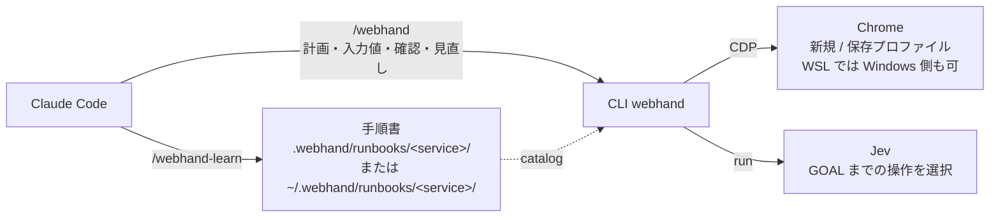

# webhand リファレンス

[English](reference.md) | 日本語

[README](../README.ja.md) の詳細です。保存場所、役割分担、セッション、コマンド、学習モード、ページの領域、ログを説明します。

## 保存場所

Claude Code の `~/.claude/` と `.claude/` と同じように、ユーザー単位とプロジェクト単位の2か所を使います。

| 場所 | パス | 内容 |
| --- | --- | --- |
| ユーザー | `~/.webhand/`（`WEBHAND_HOME` で変更可） | `runbooks/`（どのプロジェクトでも使うサービス情報と手順書）、`runs/`（実行と学習の記録。ページ本文を含む。`WEBHAND_SCREENSHOTS=1` のときはスクリーンショットも）、`state/`（実行中のセッションと保存プロファイル） |
| プロジェクト | 現在のディレクトリから上にたどって最初に見つかる `.webhand/`（ホームディレクトリで止まる） | `runbooks/`（そのプロジェクトのサービス情報と手順書。git で共有できる） |

- 手順書とサービス情報は、プロジェクト、ユーザーの順に探します。同じ名前ならプロジェクトのものを使います。`catalog` は両方を一覧し、それぞれの出所を `(project)` / `(user)` で示します。
- `learn` は既定でプロジェクトに書きます（`.webhand/` がなければ git のルート、なければ現在のディレクトリに作ります）。`--scope user` でユーザーに書きます。
- ログイン状態と実行記録はユーザー単位にだけ置き、プロジェクトには置きません。API キーはファイルに置かず、環境変数（`TYPESAFE_API_KEY`）からだけ読みます。



## 役割分担

| 担当 | 役割 |
| --- | --- |
| Claude | GOAL と手順を計画する、入力値を書く、足りない情報を質問する、結果を確認する、計画を見直す、実行を締める |
| Jev | GOAL までの操作ごとに、対象の要素と Claude の入力値のどれを使うかを番号で選ぶ |
| コード | 選択を観測済み要素と Claude の値に限定し、鮮度を確認して実行する。独立検証を行う |

`run` は、次のいずれかの場合にだけ Claude に制御を返します。

| 結果 | 発生条件 | Claude の対応 |
| --- | --- | --- |
| `GOAL_REPORTED` | Jev が GOAL 達成を申告した | ページを GOAL と照合し、`finish` か `replan` |
| `NEEDS_VALUE` | 入力欄に合う値が計画にない | `run --value "ラベル=値"`。わからなければユーザーに聞く |
| `NEEDS_HUMAN` | ログイン、認証コード、CAPTCHA、`[person]` の手順 | ユーザーに依頼し、`run --human-done` |
| `BLOCKED` / `STUCK` / `ATTEMPT_BUDGET` | 進めなくなった | `replan` で再挑戦、`act` で1手補う、または `finish` |
| `JEV_FAILED` | Jev の応答が使えない（何も実行していない） | もう一度 `run`、`replan`、または `act` |
| `UNCERTAIN` | 操作が実行されたかどうか不明 | 繰り返さず、`finish --status error` |

確信度は記録しますが、Jev を止める条件には使いません。

## セッション

| `--session` | 内容 |
| --- | --- |
| `new`（既定） | 一時プロファイル。ログインしていない状態で始まり、終了時に削除されます |
| `profile:NAME` | webhand 専用の保存プロファイル。ログイン状態が次回も残ります |

```bash
webhand profile login work --url https://example.com/login   # 人がログインしてウィンドウを閉じる
webhand profile list
webhand profile delete work
```

普段使いの Chrome プロファイルには接続しません。Chrome 136 以降は、既定のプロファイルへのデバッグ接続ができないためです。保存プロファイルは、Linux では `~/.webhand/state/profiles/`、Windows では `%LOCALAPPDATA%\webhand\profiles\` に置かれます。

**ログイン後のページの内容は Jev（TypeSafe の API）に送られます。** 個人情報を含む画面を扱うかどうかは、実行前に判断してください。

## WSL で Windows 側の Chrome を使う

`--chrome auto`（既定）は、WSL 上で Windows の `chrome.exe` に接続できればそれを使い、できなければ Linux の Chrome を使います。`--chrome windows` または `--chrome linux` で固定でき、`WEBHAND_CHROME` でも指定できます。

Windows の Chrome は、デバッグポートを Windows の 127.0.0.1 で待ち受けます。そのため、WSL のネットワークを mirrored にする必要があります。

```ini
# %USERPROFILE%\.wslconfig
[wsl2]
networkingMode=mirrored
```

設定したら、PowerShell で `wsl --shutdown` を実行して WSL を再起動します。ローカルファイルの URL は `file://wsl.localhost/...` に変換して開きます。

## コマンド

下の表の `webhand` は、インストールしていなければ `npx -y webhand@0.3` と読み替えてください。`webhand --version` で版を確認できます。

| コマンド | 担当 | 内容 |
| --- | --- | --- |
| `webhand catalog` | Claude | 学習済みのサービス、手順書、保存プロファイルを一覧する |
| `webhand start --goal G --url U --step S ... --value L=V ... --session ...` | Claude | 計画を記録し、Chrome で開始 URL を開く |
| `webhand run` | Jev | GOAL まで操作する |
| `webhand replan --reason R [--step ...] [--value ...] [--focus ...] [--skip ...] [--restart]` | Claude | 計画を見直して、次の試行を始める |
| `webhand act OP [TARGET]` | Claude | Jev の代わりに操作を1つ実行する |
| `webhand observe` | Claude | 現在のページを表示する |
| `webhand finish --status STATUS` | Claude | 独立検証、ログ記録、Chrome の終了 |
| `webhand learn --name NAME --url URL [--scope project\|user]` | 人 | 操作を記録する |
| `webhand profile login/list/delete` | 人 | 保存プロファイルを管理する |

手順の先頭に `[person]` を付けると、人が行う手順になります（`--headed` が必須です）。`start` と `replan` の `--focus REGION` / `--skip REGION` で、観測する領域を選べます（下の「ページの領域」）。`--runbook NAME --param k=v` を指定すると、手順書の GOAL、開始 URL、手順が既定値になり、params は入力値として Jev に渡されます。

## 学習モード

人の操作、サービスのソースコード、または過去の実行ログから、次の2種類のファイルを作ります。

| ファイル | 内容 | 使われ方 |
| --- | --- | --- |
| `runbooks/<service>/service.toml` | サービスの説明、ログインの要否、ページと領域の一覧、Jev 向けの事実 | `catalog` で Claude が読み、`--service` で Jev に渡す |
| `runbooks/<service>/<name>.toml` | 手順書（goal、params、steps、hints、done_when、focus、skip） | Claude の計画の下敷き。手順と hints は Jev にも渡す |

どちらも、プロジェクトの `.webhand/` かユーザーの `~/.webhand/` に置きます（「保存場所」）。`learn` は書き込み先を `WRITE THE RUNBOOK TO ...` として表示します。`start_url` にローカルファイルの相対パスを書くと、その `.webhand/` を含むディレクトリからのパスになります。

```text
/webhand-learn --name myservice/search --url https://example.com
```

1. `webhand learn` が Chrome を開き、ユーザーの操作を記録します。ウィンドウを閉じると終了します。ログインした状態で操作を見せる場合は、`--session profile:NAME` を付けます。バックグラウンドのジョブを止めても（SIGTERM、または npx の終了）、記録を保存して Chrome を閉じます。
2. Claude が記録またはソースコードから、サービス情報と手順書の下書きを書きます。
3. `--runbook NAME --param k=v --allow-draft` で試行します。
4. ユーザーが内容を確認し、`status = "approved"` にします。

手順書は機械的に再生しません。

`sources` は任意の欄で、webhand は読みません。書くのは、誰でもたどれる参照（`code:<パス>@<commit>` など）だけです。実演、実行、試行は書きません。それらのログはユーザー側の `runs/` にしかないためです。実行ログには手順書の `digest` が残る（`run_start` と `run_end`）ので、ある版の手順書を使った実行はログから探せます。ファイルを変えるのは、学習した内容が変わるときと承認するときだけで、試行を記録するためには変えません。何を学んだかはコミットメッセージに書きます。

### まだ学習していない手順

学習済みのサービスであれば、手順書のない手順も実行できます。Claude が catalog から GOAL、開始 URL（サービスのページ一覧から選ぶ）、手順（`--step`）を書きます。`--runbook` がなくても、`--service SERVICE` でサービス情報が Jev に渡ります。

```text
webhand start --goal "..." --url "..." --step "..." --service myservice --session new
```

- そのまま効くもの: サービスの `facts`、`default = "skip"` の領域。
- 使えないもの: 手順書だけが持つ `hints`、`done_when`、`focus`。その分 Claude の計画に頼るため、計画の見直しが増えることがあります。
- 次回も使うなら、その実行から学習させます（次の節）。`draft` の手順書になります。

### 実行から学ぶ

`/webhand` の実行だけでは、学習済みの内容は変わりません。計画を見直した、`blocked` で終わった、手順書なしで `done` になった実行では、Claude がログの場所を伝えます。そのログから学習させられます。

```text
/webhand-learn ~/.webhand/runs/<timestamp>/adhoc.jsonl
```

- Claude は、自分が書いた見直しの理由（`attempt_end`）、`run` が止まった理由（`escalation`）、成功した試行で操作した要素と領域（`step`、`page`）を読みます。
- サービスの性質は service.toml の `facts` に、ひとつの手順に関することは手順書の `hints`、`steps`、`focus`、`skip` に書きます。手順書なしで `done` になった実行からは、新しい手順書を作れます。
- 根拠にするのは Claude の理由とログの構造だけです。ページ本文は使いません。
- 変えた手順書は、`approved` だったものも `draft` に戻ります。試行してから承認してください。

記録の扱い:

- キー入力は記録しません。パスワード、ワンタイムコード、カード番号などの欄の値は `<redacted>` になります。ただし秘匿の判定は欄の属性と名前によるため、見分けられない欄の値は `runs/` の記録に残ります
- URL のクエリの値はすべて伏せます
- 記録はユーザー単位の `runs/`（既定は `~/.webhand/runs/`）に保存されます。ページ本文を含むため、共有しないでください
- iframe 内の操作、ファイル選択、新しいタブは再現できないため、`unsupported` として残します
- ページのスクリプトは記録を偽装できるため、記録は信頼せず、手順書はユーザーが承認します

## ページの領域

観測は、テキスト 6000 文字、操作 250 件が上限です。ページは領域（header、nav、main、form、fieldset、table、dialog、ラベル付きの section など）に分けて観測します。領域のキーは、外側の領域からの並びです。

```text
main/form:宿泊予約/fieldset:追加プラン   # 種類:名前。名前は aria-label、legend、caption、領域の先頭の見出しから取る
nav#2                                    # 名前のない同じ種類が並ぶときは順番
```

- 観測結果の `regions` には、領域ごとに位置（`above` / `visible` / `below`）、テキストと操作の表示数と全数、画面外の操作の数が入ります。Claude には `REGIONS`、Jev には `page.regions` として渡ります。何が切り捨てられたかがわかります。
- `focus` の領域は先頭に並び、テキストはページ全体から取ります。`skip` の領域は要約にだけ出ます。どちらもないときは、画面内を DOM 順に取ります。開いた dialog は、view があるときは常に先頭です。
- パターンはキーのどこに一致してもよく、一致した領域の内側も含みます。名前や番号のない段（`form`）は、その種類のどの領域にも一致します。focus と skip の両方に一致したら、深いほうが勝ちます（同じ深さなら focus）。
- 操作の対象は view に関係なく画面内だけです。鮮度の判定（`marker`、`page_key`、`guards`）は、view に関係なく同じ入力から計算します。
- view は、service.toml の `default`、手順書の `focus` / `skip`、Claude の `--focus` / `--skip` の順に重ね、後のものが勝ちます。`run_start` と `plan` のイベントに `view` が残ります。

```toml
# service.toml
[[pages.regions]]
key = "main/form:宿泊予約"
purpose = "予約フォーム"
[[pages.regions]]
key = "footer"
purpose = "サイト共通のリンク"
default = "skip"       # focus か skip。なしなら通常

# 手順書
focus = ["form:宿泊予約"]
skip = ["header", "footer"]
```

学習の記録では、`page` イベントに領域の要約（キーと件数だけ）、`action` イベントに対象の領域キーが入ります。秘密に見える名前の段は `form:<redacted>` になります。

`verify()` のないサービスでは `verified` は `null` です。手順書の `done_when` は Claude の確認材料で、成功の証拠にはなりません。

## ログ

ユーザー単位の `runs/<時刻>/`（既定は `~/.webhand/runs/`）に JSONL で出力されます。

| type | 内容 |
| --- | --- |
| `run_start` | 目標、Chrome（linux / windows）、セッションの種類、git commit、手順書、サービス |
| `start_failed` | `start` がページを開けなかった理由（エラーの1行目。URL の値は伏せる）、開始 URL、Chrome、セッションの種類。この実行には `run_start` がない |
| `plan` | 試行ごとの手順、入力値のラベル、その出所（`claude` / `runbook`）、`restart` |
| `call` | Jev の呼び出しごとのトークンと遅延 |
| `step` / `step_result` | 実行した操作、その領域、入力した値のラベル（値そのものは残さない）と `text_chars`、試行番号、判断者、確信度、ページの変化。URL のクエリ値は伏せる |
| `page` | 開始時とページが変わるたびの領域の要約（キーと件数だけ。本文は入れない） |
| `escalation` | `run` が Claude に返した結果 |
| `human_step` / `values` | 人の手順の依頼と完了、追加された入力値のラベル |
| `attempt_end` | 試行の結果と、Claude が書いた見直しの理由 |
| `handoff` | Claude が読む CLI 出力の文字数 |
| `screenshot` / `screenshot_failed` | `WEBHAND_SCREENSHOTS=1` のときだけ。画像がどの手順と試行のあとか、何のあとか（`start` / `action` / `restart`）、`<ログ名>-screenshots/` 内のファイル、クエリ値を伏せた URL。撮影に失敗しても記録して実行を続ける |
| `run_end` | 自己申告の状態と Claude の `reason`、サービス、手順書、独立検証の結果、試行回数と試行ごとの結果、`actions`（実行した操作だけ）、`stale` と `not_visible`（実行しなかった選択）、役割ごとの集計 |

成功判定は `run_end.verified` です。`status=done` は申告にすぎません。Claude Code のトークン数は取得しないため、`handoffs`（Claude に戻した回数）と `handoff_chars`（読ませた文字数）を代理指標にします。

