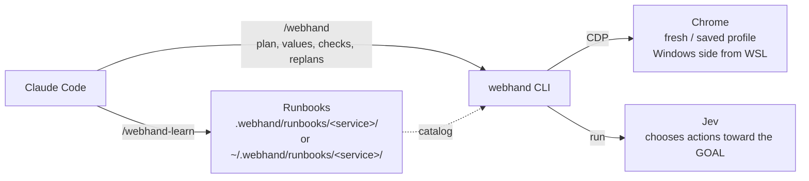

# webhand reference

English | [日本語](reference.ja.md)

Details behind the [README](../README.md): where files live, what each role does, sessions, commands, learning mode, page regions, and logs.

## Where things are stored

Like Claude Code's `~/.claude/` and `.claude/`, webhand uses two locations: one per user and one per project.

| Scope | Path | Contents |
| --- | --- | --- |
| User | `~/.webhand/` (override with `WEBHAND_HOME`) | `runbooks/` (service information and runbooks used in every project), `runs/` (run and learning logs, including page text), `state/` (active sessions and saved profiles) |
| Project | The first `.webhand/` found walking up from the current directory (stops at the home directory) | `runbooks/` (the project's service information and runbooks; can be shared through git) |

- Runbooks and service information are looked up in the project first, then the user folder. When names collide, the project's version wins. `catalog` lists both and marks each entry `(project)` or `(user)`.
- `learn` writes to the project by default (creating `.webhand/` at the git root if none exists, or in the current directory outside git). Use `--scope user` to write to the user folder.
- Login state and run logs live only in the user folder, never in the project. The API key is never stored in a file; it is read only from the `TYPESAFE_API_KEY` environment variable.



## Division of roles

| Who | Role |
| --- | --- |
| Claude | Plans the GOAL and steps, writes input values, asks for missing information, checks the result, replans, closes the run |
| Jev | For each action toward the GOAL, picks by number which element to act on and which of Claude's values to use |
| Code | Restricts choices to observed elements and Claude's values, checks freshness before acting, and runs independent verification |

`run` hands control back to Claude only in these cases:

| Result | When | What Claude does |
| --- | --- | --- |
| `GOAL_REPORTED` | Jev reports the GOAL as reached | Compares the page with the GOAL, then `finish` or `replan` |
| `NEEDS_VALUE` | No planned value fits an input field | `run --value "label=value"`; asks the user if unsure |
| `NEEDS_HUMAN` | Login, verification code, CAPTCHA, or a `[person]` step | Asks the user, then `run --human-done` |
| `BLOCKED` / `STUCK` / `ATTEMPT_BUDGET` | No way forward | `replan` to retry, `act` to fill in one action, or `finish` |
| `JEV_FAILED` | Jev's response was unusable (nothing was executed) | `run` again, `replan`, or `act` |
| `UNCERTAIN` | Unknown whether an action took effect | Does not repeat it; `finish --status error` |

Confidence is logged but never used to stop Jev.

## Sessions

| `--session` | Description |
| --- | --- |
| `new` (default) | A temporary profile. Starts logged out and is deleted when the run ends |
| `profile:NAME` | A saved profile dedicated to webhand. Login state persists across runs |

```bash
webhand profile login work --url https://example.com/login   # a person logs in, then closes the window
webhand profile list
webhand profile delete work
```

webhand never connects to your everyday Chrome profile, because Chrome 136 and later refuse debugging connections to the default profile. Saved profiles live in `~/.webhand/state/profiles/` on Linux and `%LOCALAPPDATA%\webhand\profiles\` on Windows.

**Pages viewed while logged in are sent to Jev (the TypeSafe API).** Decide before each run whether it is acceptable to handle screens that contain personal information.

## Using Windows Chrome from WSL

With `--chrome auto` (the default), webhand on WSL uses Windows `chrome.exe` when it can connect to it, and falls back to Linux Chrome otherwise. Use `--chrome windows` or `--chrome linux` to pin one, or set `WEBHAND_CHROME`.

Windows Chrome listens for debugging on Windows' 127.0.0.1, so WSL networking must be set to mirrored:

```ini
# %USERPROFILE%\.wslconfig
[wsl2]
networkingMode=mirrored
```

Then restart WSL by running `wsl --shutdown` in PowerShell. Local file URLs are opened as `file://wsl.localhost/...`.

## Commands

If the CLI is not installed globally, read `webhand` in the table below as `npx -y webhand@0.2`. `webhand --version` prints the version.

| Command | Used by | Description |
| --- | --- | --- |
| `webhand catalog` | Claude | Lists learned services, runbooks, and saved profiles |
| `webhand start --goal G --url U --step S ... --value L=V ... --session ...` | Claude | Records the plan and opens the start URL in Chrome |
| `webhand run` | Jev | Operates the page toward the GOAL |
| `webhand replan --reason R [--step ...] [--value ...] [--focus ...] [--skip ...] [--restart]` | Claude | Revises the plan and starts the next attempt |
| `webhand act OP [TARGET]` | Claude | Performs a single action in Jev's place |
| `webhand observe` | Claude | Shows the current page |
| `webhand finish --status STATUS` | Claude | Runs independent verification, writes the log, and closes Chrome |
| `webhand learn --name NAME --url URL [--scope project\|user]` | Person | Records a demonstration |
| `webhand profile login/list/delete` | Person | Manages saved profiles |

Prefix a step with `[person]` to make it a step a human performs (requires `--headed`). `--focus REGION` / `--skip REGION` on `start` and `replan` choose which regions are observed (see [Page regions](#page-regions)). With `--runbook NAME --param k=v`, the runbook's GOAL, start URL, and steps become the defaults, and the params are passed to Jev as input values.

## Learning mode

From a human demonstration or the service's source code, webhand produces two kinds of files:

| File | Contents | How it is used |
| --- | --- | --- |
| `runbooks/<service>/service.toml` | Service description, whether login is required, pages and their regions, facts for Jev | Claude reads it through `catalog`; passed to Jev with `--service` |
| `runbooks/<service>/<name>.toml` | Runbook (goal, params, steps, hints, done_when, focus, skip) | The basis for Claude's plan; steps and hints are also passed to Jev |

Both go in the project's `.webhand/` or the user's `~/.webhand/` (see [Where things are stored](#where-things-are-stored)). `learn` prints the destination as `WRITE THE RUNBOOK TO ...`. A relative local-file path in `start_url` is resolved from the directory that contains that `.webhand/`.

```text
/webhand-learn --name myservice/search --url https://example.com
```

1. `webhand learn` opens Chrome and records what you do. Closing the window ends the recording. To demonstrate while logged in, add `--session profile:NAME`. If the background job is stopped (SIGTERM, or npx exiting), the recording is saved and Chrome is closed.
2. Claude drafts the service information and the runbook from the recording or the source code.
3. Try it with `--runbook NAME --param k=v --allow-draft`.
4. You review the content and set `status = "approved"`.

Runbooks are never replayed mechanically.

How recordings are handled:

- Keystrokes are not recorded. Values of password, one-time code, card number, and similar fields become `<redacted>`. Detection relies on field attributes and names, so values of fields it cannot recognize remain in the `runs/` log
- All URL query values are masked
- Recordings are saved under the user folder's `runs/` (`~/.webhand/runs/` by default). They contain page text, so do not share them
- Actions inside iframes, file pickers, and new tabs cannot be reproduced and are kept as `unsupported`
- Page scripts can forge recordings, so recordings are not trusted; you approve the runbook

## Page regions

An observation is capped at 6,000 characters of text and 250 actions. The page is observed split into regions (header, nav, main, form, fieldset, table, dialog, labeled sections, and so on). A region key is the path of regions from the outermost one.

```text
main/form:Reservation/fieldset:Add-ons   # kind:name. The name comes from aria-label, legend, caption, or the region's first heading
nav#2                                    # sibling regions of the same kind without names are numbered
```

- The `regions` field of an observation lists, per region, its position (`above` / `visible` / `below`), shown and total counts of text and actions, and the number of off-screen actions. Claude sees it as `REGIONS` and Jev as `page.regions`, so it is clear what was cut.
- `focus` regions come first, and their text is taken from the whole page. `skip` regions appear only in the summary. With neither, the visible part of the page is taken in DOM order. An open dialog always comes first when a view is set.
- A pattern may match anywhere in a key and includes everything inside the matched region. A segment without a name or number (`form`) matches any region of that kind. If a region matches both focus and skip, the deeper match wins (focus on a tie).
- Action targets are always limited to the visible part, regardless of the view. Freshness checks (`marker`, `page_key`, `guards`) are computed from the same input regardless of the view.
- Views are layered in this order, later ones winning: `default` in service.toml, the runbook's `focus` / `skip`, then Claude's `--focus` / `--skip`. The `run_start` and `plan` events record the `view`.

```toml
# service.toml
[[pages.regions]]
key = "main/form:Reservation"
purpose = "Booking form"
[[pages.regions]]
key = "footer"
purpose = "Site-wide links"
default = "skip"       # focus or skip; omit for normal

# runbook
focus = ["form:Reservation"]
skip = ["header", "footer"]
```

In learning logs, `page` events carry a region summary (keys and counts only) and `action` events carry the target's region key. Segments whose names look secret become `form:<redacted>`.

For services without `verify()`, `verified` is `null`. A runbook's `done_when` is material for Claude's check, not evidence of success.

## Logs

Logs are written as JSONL to `runs/<timestamp>/` in the user folder (`~/.webhand/runs/` by default).

| type | Contents |
| --- | --- |
| `run_start` | Goal, Chrome (linux / windows), session kind, git commit, runbook, service |
| `plan` | Steps per attempt, input value labels and their source (`claude` / `runbook`), `restart` |
| `call` | Tokens and latency of each Jev call |
| `step` / `step_result` | The action taken, attempt number, decider, confidence, page change |
| `escalation` | The result `run` returned to Claude |
| `human_step` / `values` | Requests and completions of human steps, labels of added input values |
| `attempt_end` | Outcome of the attempt and Claude's reason for replanning |
| `handoff` | Number of characters of CLI output Claude reads |
| `run_end` | Self-reported status, independent verification result, attempt count and per-attempt outcomes, per-role totals |

Success is judged by `run_end.verified`; `status=done` is only a claim. Claude Code's token usage is not available, so `handoffs` (times control returned to Claude) and `handoff_chars` (characters Claude read) serve as proxies.

