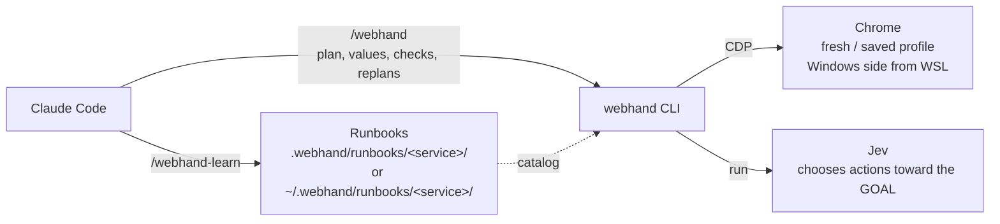

# webhand reference

English | [日本語](reference.ja.md)

Details behind the [README](../README.md): where files live, what each role does, sessions, commands, learning mode, page regions, and logs.

## Where things are stored

Like Claude Code's `~/.claude/` and `.claude/`, webhand uses two locations: one per user and one per project.

| Scope | Path | Contents |
| --- | --- | --- |
| User | `~/.webhand/` (override with `WEBHAND_HOME`) | `runbooks/` (service information and runbooks used in every project), `runs/` (run and learning logs, including page text, and screenshots when `WEBHAND_SCREENSHOTS=1`), `state/` (active sessions and saved profiles) |
| Project | The first `.webhand/` found walking up from the current directory (stops at the home directory) | `runbooks/` (the project's service information and runbooks; can be shared through git) |

- Runbooks and service information are looked up in the project first, then the user folder. When names collide, the project's version wins. `catalog` lists both and marks each entry `(project)` or `(user)`.
- `learn` writes to the project by default (creating `.webhand/` at the git root if none exists, or in the current directory outside git). Use `--scope user` to write to the user folder.
- Login state and run logs live only in the user folder, never in the project. The API key is never stored in a file; it is read only from the `TYPESAFE_API_KEY` environment variable.



## Division of roles

| Who | Role |
| --- | --- |
| Claude | Plans the GOAL and steps, writes input values, asks for missing information, checks the result, replans, closes the run |
| Jev | For each action toward the GOAL, picks by number which element to act on and which of Claude's values to use |
| Code | Restricts choices to observed elements and Claude's values, checks freshness before acting, and runs independent verification |

`run` hands control back to Claude only in these cases:

| Result | When | What Claude does |
| --- | --- | --- |
| `GOAL_REPORTED` | Jev reports the GOAL as reached | Compares the page with the GOAL, then `finish` or `replan` |
| `NEEDS_VALUE` | No planned value fits an input field | `run --value "label=value"`; asks the user if unsure |
| `NEEDS_HUMAN` | Login, verification code, CAPTCHA, or a `[person]` step | Asks the user, then `run --human-done` |
| `BLOCKED` / `STUCK` / `ATTEMPT_BUDGET` | No way forward | `replan` to retry, `act` to fill in one action, or `finish` |
| `ESCALATE` | Jev hands the decision to Claude (flow v2): a step the goal does not ask for that deletes, pays, sends, or cannot be undone, or a page the plan does not cover where nothing offered fits | Reads `WHY:`, then `answer` so the same attempt goes on |
| `JEV_FAILED` | Jev's response was unusable (nothing was executed) | `run` again, `replan`, or `act` |
| `UNCERTAIN` | Unknown whether an action took effect | Does not repeat it; `finish --status error` |

Confidence is logged but never used to stop Jev.

## Sessions

| `--session` | Description |
| --- | --- |
| `new` (default) | A temporary profile. Starts logged out and is deleted when the run ends |
| `profile:NAME` | A saved profile dedicated to webhand. Login state persists across runs |

```bash
webhand profile login work --url https://example.com/login   # a person logs in, then closes the window
webhand profile list
webhand profile delete work
```

webhand never connects to your everyday Chrome profile, because Chrome 136 and later refuse debugging connections to the default profile. Saved profiles live in `~/.webhand/state/profiles/` on Linux and `%LOCALAPPDATA%\webhand\profiles\` on Windows.

### Saved logins (`--auth`)

A saved login keeps the cookies and localStorage of a session, so a later new session can start signed in. Unlike a saved profile it is not tied to Chrome: any engine (Chrome, headless shell, Lightpanda, Obscura) can start with it.

```bash
webhand start --headed --goal ... --url https://example.com/login --step "[person] Sign in"   # a person signs in
webhand auth save work                       # keep that session's sign-in (--id NAME picks the session)
webhand start --auth work --goal ... --url https://example.com/   # a new session, already signed in
webhand auth list
webhand auth delete work
```

- `--auth` is for a new session only: it cannot be given with `--id` or with `--session profile:NAME`.
- Only the sites of the tabs open when you save are kept (their cookies, and their localStorage). On `start`, localStorage is restored for the site of the start URL; a saved site of another origin gets its cookies only, and `start` says so.
- The file is `~/.webhand/state/auth/NAME.json`, readable by you alone. It is the sign-in itself: treat it like a password, never commit it, and do not paste it. webhand never prints its contents.
- Pages opened signed in are sent to Jev (TypeSafe), as with a saved profile. Saved sign-ins expire like any other.

### Several sessions at once

Each session has its own Chrome, profile, plan, and history. Give a session a name with `--id NAME` (letters, digits, `-`, `_`; up to 40) on `start`, and the same `--id` on every later command of it (`run`, `replan`, `act`, `observe`, `finish`). Without `--id` the session is called `default`, as before.

```bash
webhand start --id a --goal "..." --url ...
webhand start --id b --goal "..." --url ...    # a second Chrome, state kept apart from a
webhand run --id a
webhand finish --id a --status done
```

- When the id is not `default`, the commands the output tells Claude to run next carry the `--id`. `webhand catalog` lists the open sessions with their goals.
- Only one command at a time runs on a session: a second one stops with "Session is busy", since two `run`s on one Chrome would act twice. A lock left by a command that died is taken over. Commands on different ids do not wait for each other.
- Starting an id that is already open stops. Two sessions cannot use the same saved profile (the second Chrome exits), and `profile login` refuses a profile an open session uses.
- Each session writes its own run log. State files are `state/session-ID.json`, `state/tab-ID`, and `state/session-ID.lock` (the default session: `session.json`, `tab`, `session.lock`).
- Not supported yet: a session shared by several people or machines, and one `run` that works on several sessions.

**Pages viewed while logged in are sent to Jev (the TypeSafe API).** Decide before each run whether it is acceptable to handle screens that contain personal information.

## Using Windows Chrome from WSL

With `--chrome auto` (the default), webhand on WSL uses Windows `chrome.exe` when it can connect to it, and falls back to Linux Chrome otherwise. Use `--chrome windows` or `--chrome linux` to pin one, or set `WEBHAND_CHROME`.

Windows Chrome listens for debugging on Windows' 127.0.0.1, so WSL networking must be set to mirrored:

```ini
# %USERPROFILE%\.wslconfig
[wsl2]
networkingMode=mirrored
```

Then restart WSL by running `wsl --shutdown` in PowerShell. Local file URLs are opened as `file://wsl.localhost/...`.

## Headless shell

`--engine headless-shell` (or `auto`, below) runs the session on `chrome-headless-shell`, Chromium's windowless build. It is the same engine as Chrome (real layout, several tabs, a page that stays when a command ends), so it needs no daemon. It uses about half the memory of Chrome's `--headless=new`: roughly 240–260 MB for one page against 350–470 MB, in the same measurement (see `docs/research-plan.md`).

- Install: Playwright's `chromium_headless_shell` build is found in its browser cache (`~/.cache/ms-playwright`, or `PLAYWRIGHT_BROWSERS_PATH`), or set `WEBHAND_HEADLESS_SHELL` to the binary, or put `chrome-headless-shell` on `PATH`.
- The page is 1120x780, the same as Chrome. Chrome's window includes 87px of browser UI (`--window-size=1120,867`); the shell has none, so it is started with `1120,780`. With the same window size the two read different elements.
- No window and no saved profile (`--headed`, `[person]` steps, `learn`, `profile` are refused, and `--chrome windows` does not apply). A profile made by Chrome may be newer than the shell's build.
- It is the default for a run that needs no window and no saved profile (`--engine auto`, the default; or `WEBHAND_ENGINE`). A window (`--headed`), a saved profile, or `--chrome windows` keeps Chrome, and so does a missing shell, quietly. `--engine chrome` always uses Chrome. The `SESSION:` line says which one ran.

## Lightpanda

`--engine lightpanda` runs the session on [Lightpanda](https://lightpanda.io) instead of Chrome (`--engine` is `auto`, `chrome`, `headless-shell`, `lightpanda`, `obscura` or `browser-run`; the default is `auto`, or `WEBHAND_ENGINE`). `--chrome auto|linux|windows` says only where Chrome runs and does not apply to an engine. Lightpanda drops its pages when a CDP connection ends, and every webhand command connects anew, so webhand starts a small daemon (`src/daemon.ts`) that runs `lightpanda serve`, holds the one connection and page for the session, and answers the commands over an owner-only unix socket in the session's temporary folder (`state.socket`). The daemon runs the same `Browser`, so the freshness check and the no-retry rule apply as with Chrome. `finish` stops the daemon and Lightpanda together. Chrome sessions do not use the daemon.

Limits:

- No saved profile (`--session new` only), no window (`--headed`, `[person]` steps, `learn` and `profile` are refused).
- `file:` URLs cannot be opened (serve the page over http), and a second tab cannot be opened. A link with `target="_blank"` or `window.open` does nothing and raises no error: the page stays as it was. The run log records a `window_ignored` event (step and URLs) after such a step, so a click that "did nothing" can be told from one that was refused. Jev gets no new option for it.
- No layout: element positions are simulated and screenshots are placeholders, so what Jev is shown differs from Chrome. Compare results with Chrome as a separate experiment.
- `lightpanda` must be on `PATH`.

## Obscura

`--engine obscura` runs the session on [Obscura](https://github.com/h4ckf0r0day/obscura) (Rust, V8, Apache-2.0) the same way as Lightpanda: a daemon holds the connection and page, and commands reach it over the session's socket. Unlike Lightpanda it has real layout, real screenshots and more than one page.

- Install: unpack the release archive (`obscura` and `obscura-worker` side by side) and set `WEBHAND_OBSCURA` to the `obscura` path, or put it on `PATH`.
- Obscura refuses loopback and private addresses by default (its SSRF guard). For local pages only, set `WEBHAND_OBSCURA_ALLOW_PRIVATE=1`; leave it unset for real sites.
- Same limits as Lightpanda: no saved profile, no window (`--headed`, `[person]` steps, `learn` and `profile` are refused).
- New windows: `window.open` opens nothing and is recorded as `window_ignored`, as for Lightpanda. A `target="_blank"` link loads its target in the same tab instead (the page changes, so there is no `window_ignored`).
- Tabs: Obscura has several pages and webhand switches between them (`TAB_n`), but nothing a page does opens a second tab (see above), so in practice a run has one. Its `Page.bringToFront` is not implemented, which webhand tolerates.
- An inline element straight under `<body>` (not inside a paragraph, a block or a flex container) gets no size and is not offered; inside any block it is.
- Obscura lacks some Web APIs that Chrome has. webhand adds these to the page for it (`compat`, in `src/browser.ts`; `assets/snapshot.js` is the same for every engine): an iterable `select.selectedOptions`, `isContentEditable` (so an editable div is a textbox), a form's controls by name (`form.guest`) and a form by id (`document.forms.id`). Without the last two, a page whose handler reads `form.guest.value` throws and the form is never submitted. Not covered: a cursor set by a stylesheet rule reads as `auto` (only an inline style gives `pointer`), so an element that is clickable only through a CSS cursor is not offered.

## Browser Run

`--engine browser-run` runs the session on Cloudflare [Browser Run](https://developers.cloudflare.com/browser-run/) (formerly Browser Rendering): a headless Chrome on Cloudflare's network, reached over CDP. Nothing runs locally and the session state has no pid. `start` creates the session (`POST .../browser-run/devtools/browser?keep_alive=1200000`), every command reconnects to it with Playwright's `connectOverCDP` and an `Authorization: Bearer` header, and `finish` deletes it. It is never chosen by `auto`.

- Set `CLOUDFLARE_ACCOUNT_ID` and `CLOUDFLARE_API_TOKEN` (the "Browser Rendering - Edit" permission) as environment variables. They are read from the environment only and never saved in the session state.
- **The pages the run opens are sent to Cloudflare**, and with `--auth` the saved login is injected into the Browser Run session. `start` says so. Tell the user before running.
- No saved profile (`--session new` only), no window (`--headed`, `[person]` steps, `learn`, `profile` are refused). `--auth` works.
- A session closes after 60 seconds without a command unless `keep_alive` extends it; webhand asks for the longest, 20 minutes. If the session has gone, the next command fails (a change to the browser is never retried): `start` again.
- Limits depend on the Cloudflare plan (Workers Free: 3 concurrent browsers and 10 minutes a day; Paid: 200 concurrent). Results have not been compared with Chrome; treat that as a separate experiment.
- `--engine kitesurf` uses Cloudflare's other browser for the same API: Kitesurf, a stateless browser made for agents (beta, free behind per-account limits; not Chromium, so it reads some pages differently). Everything above applies, with one difference: Cloudflare does not allow `keep_alive` with it, so the session closes after the default 60 seconds without a command. Run the commands of a run without long pauses, or use `browser-run`. Checked with an example page, a form submit, `--auth` and screenshots. A link that opens a new window (`target=_blank`) can end the session about 3 seconds later, and the command then fails (2 of 3 tries; the third switched to the new tab). Do not rely on a second tab. Right after creation a session was also found already closed (`410 Gone`) twice, so Kitesurf, still in beta, may need a second `start`. The causes were not traced. Not for video, WebGL, bot challenges, or long signed-in sessions (Cloudflare's own list).

## Commands

If the CLI is not installed globally, read `webhand` in the table below as `npx -y webhand@0.4`. `webhand --version` prints the version.

| Command | Used by | Description |
| --- | --- | --- |
| `webhand catalog` | Claude | Lists learned services, runbooks, and saved profiles |
| `webhand start --goal G --url U --step S ... --value L=V ... [--file L=PATH ...] [--download-dir DIR] --session ...` | Claude | Records the plan and opens the start URL in Chrome |
| `webhand run` | Jev | Operates the page toward the GOAL |
| `webhand replan --reason R [--step ...] [--value ...] [--focus ...] [--skip ...] [--read ...] [--restart \| --url URL]` | Claude | Revises the plan and starts the next attempt, from the start URL again (`--restart`) or from another page (`--url`) |
| `webhand answer --note N [--value L=V] [--url URL]` | Claude | Answers Jev in the same attempt (flow v2 only): the history and the budget are kept. Use `replan` only when the whole plan is wrong |
| `webhand act OP [TARGET]` | Claude | Performs a single action in Jev's place |
| `webhand observe` | Claude | Shows the current page |
| `webhand check --expect KIND:ARGS ...` | Claude | Compares expectations with the page as it is now (read-only, no model). Kinds: `text:S`, `no-text:S`, `field:LABEL=V`, `checked:LABEL=true\|false`, `count:ROLE=N`, `url:/path`, `title:S`. Prints `PASS`/`FAIL`/`INCONCLUSIVE` per expectation with the quoted observation; exit 0, 6 (any FAIL), 7 (no FAIL, some INCONCLUSIVE). A negative result is `INCONCLUSIVE not_visible` unless the whole page was seen; `--read` reads the whole page's text for this call only (no `replan`, no attempt used) |
| `webhand finish --status STATUS` | Claude | Runs independent verification, writes the log, and closes Chrome |
| `webhand learn --name NAME --url URL [--scope project\|user]` | Person | Records a demonstration |
| `webhand profile login/list/delete` | Person | Manages saved profiles |
| `webhand auth save/list/delete NAME` | Claude | Saves the sign-in of a session, to start a new session with `--auth NAME` |
| `webhand knowledge list/show HOST/clear [HOST]` | Person | Shows or deletes what webhand learned about sites from its own runs (flow v2) |

Prefix a step with `[person]` to make it a step a human performs (requires `--headed`). `--focus REGION` / `--skip REGION` on `start` and `replan` choose which regions are observed (see [Page regions](#page-regions)), and `--read KIND` adds content from beyond the viewport (see [Reading beyond the viewport](#reading-beyond-the-viewport)). With `--runbook NAME --param k=v`, the runbook's GOAL, start URL, and steps become the defaults, and the params are passed to Jev as input values.

### Flow v1 and v2

`start --flow v2` is the default. `--flow v1` or `WEBHAND_FLOW=v1` selects the earlier flow, kept as the baseline of experiments.

| | v2 (default) | v1 |
| --- | --- | --- |
| What Jev is offered | The actions of the whole page, including elements beyond the viewport (scrolled into view before acting), and elements inside frames | What is in view, plus the regions Claude chose with `--focus` / `--read` |
| When Jev cannot go on | Jev can also `ESCALATE`; Claude answers with `answer` (also after `STUCK`, `BLOCKED`, `GOAL_REPORTED`, `JEV_FAILED`) and the same attempt continues | The attempt ends with `STUCK` or `BLOCKED`; Claude runs `replan` |
| Freshness check | On the target (the page key and the target's guard); scrolls and waits are never refused | On the observed page |
| Page state | `PAGE:` line (`blocked`, `login`, `error`, ...), and a stop when the target is in a part webhand cannot see (canvas, plugin) | Not reported |
| Earlier runs | Records what clicks and selects did on each kind of page, and offers to Jev, on the same kind of page, the operations of runs that ended `done` (at most 5) | Not used |

What v2 records is kept in `~/.webhand/knowledge/<host>.json`: the kind of page (the address with ids and query values taken out) and the kind and label of the operations tried on it. Typed text, values, anything that reads as personal data, and controls inside list items (their labels are page content) are not kept. `WEBHAND_KNOWLEDGE=0` turns off recording and offering, `WEBHAND_KNOWLEDGE_USE=0` stops only the offering to Jev, and `webhand knowledge clear` deletes it.

## Learning mode

From a human demonstration, the service's source code, or the log of an earlier run, webhand produces two kinds of files:

| File | Contents | How it is used |
| --- | --- | --- |
| `runbooks/<service>/service.toml` | Service description, whether login is required, pages and their regions, facts for Jev | Claude reads it through `catalog`; passed to Jev with `--service` |
| `runbooks/<service>/<name>.toml` | Runbook (goal, params, steps, hints, done_when, focus, skip) | The basis for Claude's plan; steps and hints are also passed to Jev |

Both go in the project's `.webhand/` or the user's `~/.webhand/` (see [Where things are stored](#where-things-are-stored)). `learn` prints the destination as `WRITE THE RUNBOOK TO ...`. A relative local-file path in `start_url` is resolved from the directory that contains that `.webhand/`.

```text
/webhand-learn --name myservice/search --url https://example.com
```

1. `webhand learn` opens Chrome and records what you do. Closing the window ends the recording. To demonstrate while logged in, add `--session profile:NAME`. If the background job is stopped (SIGTERM, or npx exiting), the recording is saved and Chrome is closed.
2. Claude drafts the service information and the runbook from the recording or the source code.
3. Try it with `--runbook NAME --param k=v --allow-draft`.
4. You review the content and set `status = "approved"`.

Runbooks are never replayed mechanically.

`sources` is optional and never read by webhand. It holds only references anyone can follow, such as `code:<path>@<commit>`; demonstrations, runs, and trials are not listed, because their logs stay in the user's `runs/`. Every run log records the runbook's `digest` (`run_start` and `run_end`), so the runs of one version are found from the logs. The files change only when what was learned changes or a runbook is approved, not to record a trial; what was learned goes in the commit message.

### A procedure not learned yet

A known service can be used for a procedure that has no runbook yet. Claude writes the GOAL, the start URL (from the service's pages), and the steps (`--step`) from the catalog, and `--service SERVICE` passes the service information to Jev without `--runbook`:

```text
webhand start --goal "..." --url "..." --step "..." --service myservice --session new
```

- Used as usual: the service's `facts`, and its regions with `default = "skip"`.
- Not available: what only a runbook holds (`hints`, `done_when`, `focus`). The run relies more on Claude's plan and may need more replans.
- To reuse the procedure, learn it from the run (below); it becomes a `draft` runbook.

### Learning from a run

A `/webhand` run does not change what was learned by itself. When a run was replanned, ended `blocked`, or ended `done` without a runbook, Claude points you to the log, and you can teach webhand from it:

```text
/webhand-learn ~/.webhand/runs/<timestamp>/adhoc.jsonl
```

- Claude reads Claude's own replan reasons (`attempt_end`), where `run` stopped (`escalation`), and the elements and regions the successful attempt used (`step`, `page`).
- Facts about the service go into `facts` of service.toml; facts about one procedure go into the runbook's `hints`, `steps`, `focus`, and `skip`. A run without a runbook that ended `done` can become a new runbook.
- Lessons come from Claude's reasons and the logged structure, never from page text.
- A changed runbook goes back to `draft`, even if it was `approved`. Try it again, then approve it.

How recordings are handled:

- Keystrokes are not recorded. Values of password, one-time code, card number, and similar fields become `<redacted>`. Detection relies on field attributes and names, so values of fields it cannot recognize remain in the `runs/` log
- All URL query values are masked
- Recordings are saved under the user folder's `runs/` (`~/.webhand/runs/` by default). They contain page text, so do not share them
- Actions inside iframes and file pickers cannot be reproduced and are kept as `unsupported`
- A new tab is recorded as a `tab` event (`opened` or `closed`, with how many tabs are open; `switched` when a tab comes to the front), and what you do in it is recorded as usual, with its own URL. The runbook then has a step that switches to the tab (see [Tabs](#tabs)). `switched` comes from the page, so a page can only report that its own tab came to the front; it is not seen in headless Chrome
- Page scripts can forge recordings, so recordings are not trusted; you approve the runbook

## Page regions

An observation is capped at 6,000 characters of text and 250 actions. The page is observed split into regions (header, nav, main, form, fieldset, table, dialog, labeled sections, and so on). A region key is the path of regions from the outermost one.

```text
main/form:Reservation/fieldset:Add-ons   # kind:name. The name comes from aria-label, legend, caption, or the region's first heading
nav#2                                    # sibling regions of the same kind without names are numbered
```

- The `regions` field of an observation lists, per region, its position (`above` / `visible` / `below`), shown and total counts of text and actions, and the number of off-screen actions. Claude sees it as `REGIONS` and Jev as `page.regions`, so it is clear what was cut.
- `focus` regions come first, and their text is taken from the whole page. `skip` regions appear only in the summary. With neither, the visible part of the page is taken in DOM order. An open dialog always comes first when a view is set.
- A pattern may match anywhere in a key and includes everything inside the matched region. A segment without a name or number (`form`) matches any region of that kind. If a region matches both focus and skip, the deeper match wins (focus on a tie).
- In flow v1, action targets are always limited to the visible part, regardless of the view (flow v2 also offers elements beyond the viewport). Freshness checks (`marker`, `page_key`, `guards`) are computed from the same input regardless of the view.
- Views are layered in this order, later ones winning: `default` in service.toml, the runbook's `focus` / `skip`, then Claude's `--focus` / `--skip`. The `run_start` and `plan` events record the `view`.

```toml
# service.toml
[[pages.regions]]
key = "main/form:Reservation"
purpose = "Booking form"
[[pages.regions]]
key = "footer"
purpose = "Site-wide links"
default = "skip"       # focus or skip; omit for normal

# runbook
focus = ["form:Reservation"]
skip = ["header", "footer"]
```

In learning logs, `page` events carry a region summary (keys and counts only) and `action` events carry the target's region key. Segments whose names look secret become `form:<redacted>`.

For services without `verify()`, `verified` is `null`. A runbook's `done_when` is material for Claude's check, not evidence of success.

## Reading beyond the viewport

In flow v1 (and for text in both flows), Jev and Claude normally see only the visible part of the page: about 500 characters of text on a typical page, while the whole page may hold tens of thousands. With `--read KIND` (repeatable) on `start` or `replan`, each observation adds a read layer with the chosen kinds of content from the whole page. Claude sees it as `READ` in the `run` and `observe` output, and Jev as `page.read`.

| Kind | What it holds |
| --- | --- |
| `outline` | Headings and their levels. Always included when `--read` is given |
| `text` | Body text outside tables, lists, headings, links, and controls |
| `table` | Each table with its caption, row by row, cells separated by ` \| ` |
| `list` | Top-level list items |
| `link` | Link names, once each |
| `control` | Buttons, fields, and other controls outside the viewport: role and name only |
| `media` | Image alternative text and figure captions |

- It is for reading only. Nothing in it can be acted on; in flow v1, action targets and freshness checks stay limited to the visible part, apart from `SCROLL_TO` below (v2 also offers elements beyond the viewport). A line such as `@ below 1200px` says where the lines after it are, so Jev can scroll in the right direction.
- Text, list items, links, and controls in view are left out, since the viewport text and the elements already hold them. The outline and tables are kept whole.
- The layer holds at most 12,000 characters. Each kind gets an equal share, and a kind that needs less leaves the rest to the others. Lines are kept whole. A cut kind ends with `... N more characters`.
- With the layer on, the elements beyond the viewport (up to 60; the nearest and the farthest are kept) are offered for `SCROLL_TO` only, with where they are (`at="below 1200px"`). `SCROLL_TO` scrolls the element into the middle of the viewport and does nothing else; the next observation can then act on it. In a list that loads more items as it is scrolled, a `SCROLL_TO` on its last element loads the next items. Claude can also use it: `webhand act SCROLL_TO N`.
- `--skip` regions are never read. With `--focus`, only the focused regions (and an open dialog) are read.
- Field values are never read. Page content is untrusted data.
- `replan --read KIND` replaces the choice and keeps the regions; `--read none` turns the layer off. The `plan` event records it in `view.read`, and each `page` event records the shown and total characters per kind in `read`.
- Without `--read`, the observation, the output, and what Jev receives are unchanged.

## Comparing items in a long list

When the goal is to pick one item of a list by a criterion, `--compare CRITERION` on `start` or `replan` (such as `--compare "lowest monthly price"`) makes each attempt's first `run` compare the whole list before anything is acted on:

1. webhand scrolls to the top, then down one screen at a time (each screen overlaps the last by 120px).
2. After each scroll, Jev chooses which item best meets the criterion: one of the elements in view, given with the text of its row, card, or list item, or `KEEP` for the best so far. The best so far is kept as text, so a list that removes rows scrolled out of view works too. Before any best, `NONE` means no item fits yet.
3. The scan stops after 20 scrolls, or at the bottom of the page once two seconds of waiting add nothing more (a list that loads as it is scrolled grows there).
4. The page is scrolled back to where the best item was (and, with a read layer, to the item itself), and the normal loop goes on. Jev sees the result as `plan.compared`, its rules say to act on that item, and for the rest of the attempt its goal is that item instead of the GOAL.

Nothing is clicked or typed during the scan, and its scrolls are not counted as actions. The output shows `COMPARED (N scrolls, ...): item`. The log keeps a `compare_round` event per scroll and a `compare_end` event; a failed comparison logs `compare_failed` and changes nothing. Each new attempt compares again; `replan --compare none` turns it off. Only the page itself is scrolled, not a scrolling box inside it.

## Collecting every matching item of a long list

When the goal needs every item of a list that meets a condition, `--collect CONDITION` on `start` or `replan` (such as `--collect "200 GB of storage and less than €40 a month"`) makes each attempt's first `run` collect them and stop:

1. webhand scrolls through the page exactly as for `--compare`: from the top, one screen at a time, up to 20 scrolls or the bottom once waiting adds nothing more.
2. After each scroll, webhand reads the list and table items in view (table rows, and blocks of the same tag and class repeated three or more times side by side, such as cards built from divs, list items, or articles; navigation, headers, footers, and header rows left out; of nested items, the outer one, such as a card rather than the bullet points inside it). Each item not seen before is asked about once: Jev answers `MATCH` or `NO` for it, judging by the item's own text. Jev is given the plan and the condition, not the page.
3. The matching items are kept as text, so a list that removes rows scrolled out of view works too.
4. For the rest of the attempt, Jev works toward Claude's steps, with Claude's values named, instead of the GOAL: the part of the goal about reading the list is done. Without steps, it keeps the GOAL.

Nothing is clicked or typed, and the run stops after the scan. The output shows `COLLECTED (N scrolls, ...): M of S items meet: CONDITION` and one line per matching item (the first 100). Claude checks them against the goal and writes the answer from them; to put the answer into the page, Claude gives it as a value (`run --value 'LABEL=VALUE'`), and the next `run` goes on with the normal loop from where the page was before the scan. The log keeps a `collect_round` event per scroll and a `collect_end` event with the counts; a failed collection logs `collect_failed` and changes nothing. Each new attempt collects again; `replan --collect none` turns it off. `--compare` and `--collect` are not used together. Items that are not in a table row, list item, or article are not read, and only the page itself is scrolled.

## More items behind a button or a next page

With `--compare` or `--collect`, `--more CONTROL` on `start` or `replan` (such as `--more "Next page"` or `--more "Show more plans"`) names the control that shows more items of the list:

1. Where the list ends (the last item of the longest list on the page has come into view; what is below it is brought into view first) and again at the bottom, once waiting adds nothing more, Jev chooses which element in view is that control, given each element with the text around it, or `NONE`. Jev is given the page for this question. Each place is asked about once.
2. webhand presses it once and waits up to three seconds for the page to change (a new address, more content, or other text), then the scan goes on from the screen as it is. Without a change, or with `NONE`, the scan scrolls on from where the list ends, and stops at the bottom.
3. The control is pressed at most 10 times per scan.

Pressing is an action: it is never repeated, and an interrupted press stops the run as `UNCERTAIN`. With `--compare`, when the best item was on an earlier page, that page is opened again (it was already visited) before scrolling to the item; a list that was grown by a button is not grown again there. With `--collect`, the page ends at its top when the scan ended on a later page. The output adds `loaded more N times`, and the log keeps a `more` event per press with what changed. `replan --more none` turns it off; `--more` without `--compare` or `--collect` is refused.

## Tabs

A click can open a new tab (`target="_blank"`, `window.open`). webhand keeps the run on one tab at a time; the new tab is not observed until the run switches to it.

- With two or more tabs open, the observation shows `TABS: N open, this is tab K`, and each other tab is offered as a control `TAB_n` ("Switch to tab n: title"). Jev chooses by number, like `SCROLL_DOWN` or `WAIT`; with one tab nothing changes. `webhand act TAB_2` does the same by hand.
- A switch runs only when the number of tabs, their order, and the target's title are still what was observed. Otherwise nothing runs and the result is `STALE`. A switch changes nothing on any page.
- A new, closed, or switched tab counts as a page change, so it does not add to `STUCK`.
- A tab that closes itself leaves the run on the last tab still open.
- The tab the run is on is kept between commands in `state/tab`, because each command attaches to Chrome anew.
- The titles of the other tabs go to Jev with the observation (page text, so treat them as untrusted). With a saved profile, that includes tabs you are logged in to.
- Not supported yet: closing a tab, and switching automatically to a tab a click opened.

## Logs

Logs are written as JSONL to `runs/<timestamp>/` in the user folder (`~/.webhand/runs/` by default).

| type | Contents |
| --- | --- |
| `run_start` | Goal, Chrome (linux / windows), session kind, git commit, runbook, service |
| `start_failed` | Why `start` could not open the page (the error's first line with URL values masked), the start URL, Chrome, session kind. The run has no `run_start` |
| `plan` | Steps per attempt, input value labels and their source (`claude` / `runbook`), `restart` |
| `call` | Tokens and latency of each Jev call |
| `step` / `step_result` | The action taken, its region, the label of the value typed (never the text) and `text_chars`, attempt number, decider, confidence, page change. URL query values are masked |
| `page` | The region outline at start and after each page change (keys and counts only, no page text). With `--read`, `read` holds the shown and total characters per kind |
| `escalation` | The result `run` returned to Claude |
| `human_step` / `values` | Requests and completions of human steps, labels of added input values |
| `attempt_end` | Outcome of the attempt and Claude's reason for replanning |
| `handoff` | Number of characters of CLI output Claude reads |
| `screenshot` / `screenshot_failed` | Only with `WEBHAND_SCREENSHOTS=1`: the step and attempt an image follows, what it follows (`start` / `action` / `restart`), its file in `<log>-screenshots/`, and the URL with query values masked. A failed capture is logged and the run goes on |
| `page_check` / `page_check_failed` | After `start` (`when: start`) and when `run` stops at `BLOCKED`, `STUCK`, `ATTEMPT_BUDGET`, or `NEEDS_HUMAN` (`when: escalation`): the attempt, the URL with query values masked, the document's HTTP status, the page title (up to 120 characters), bot-check markers found (`cloudflare`, `recaptcha`, `hcaptcha`, `datadome`, `perimeterx`, `arkose`; a sign, not proof), and the visible text length. Read-only and never sent to Jev. A failed check is logged and the run goes on |
| `run_end` | Self-reported status and Claude's `reason`, service, runbook, independent verification result, attempt count and per-attempt outcomes, `actions` (executed actions only), `stale` and `not_visible` (choices that did not run), per-role totals |

Success is judged by `run_end.verified`; `status=done` is only a claim. Claude Code's token usage is not available, so `handoffs` (times control returned to Claude) and `handoff_chars` (characters Claude read) serve as proxies.

## Upload and download

- **Upload**: a visible `<input type="file">` is offered as `UPLOAD_FILE`. Claude names the files Jev may use with `--file "LABEL=PATH"` (on `start`, `run`, `answer`, `replan`); Jev chooses a label, never a path, and the label is the only thing it sees. A file must be under the current directory; saved state and `.env` files are refused. `act UPLOAD_FILE N --file LABEL` does it for Claude. A file input hidden by the page (an upload button that opens it) is not offered yet.
- **Download**: `start --download-dir DIR` saves what a click downloads into DIR (an existing name gets ` (1)`). `act` prints `DOWNLOADED: name (bytes)`, and the step in the log and in Jev's history keeps `downloads`. Claude checks the file; its contents are never sent to Jev. A download that begins more than 1.5 s after the click is not seen by that step.
- Both need a local Chrome (`--engine chrome` on Linux, or `headless-shell`); not the Windows Chrome for downloads, not `lightpanda`, `obscura`, or the Cloudflare engines.
