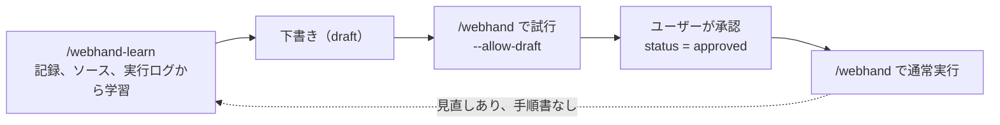

# webhand 利用ガイド（スキルと CLI）

[English](usage.md) | 日本語

webhand は、Claude Code のスキルから CLI を呼び出して使います。普段はスキルだけを使い、CLI は Claude が実行します。CLI を直接使うのは、保存プロファイルの管理、デバッグ、研究用の実行のときです。

- 背景と全体像: [README.ja.md](../README.ja.md)
- 開発者向け: [DEVELOPMENT.ja.md](../DEVELOPMENT.ja.md)

## 準備

1. プラグインを入れます（Claude Code）。

   ```text
   /plugin marketplace add sakamoto66/webhand
   /plugin install webhand@webhand
   ```

2. Jev の API キーを環境変数に設定し、Claude Code を起動し直します。ファイル（`.env` など）には置きません。

   ```bash
   echo 'export TYPESAFE_API_KEY=...' >> ~/.bashrc
   # 使うモデルを変えるとき: export TYPESAFE_MODEL=...
   ```

3. 動作を確認します。CLI はインストール不要で、スキルは `npx -y webhand@0.3` を使います。`npm i -g webhand` で入れておくと、スキルは `webhand` を直接使い、起動が速くなります。

   ```bash
   npx -y webhand@0.3 --version
   npx -y webhand@0.3 catalog
   ```

必要なもの: Node.js 22 以上、Google Chrome（Linux、または WSL から Windows 側）。

> **注意**: 操作中のページの内容は Jev（TypeSafe の API）に送られます。保存プロファイルでログインしたページも同じです。

---

## スキルの使い方

スキルは2つです。

| スキル | 用途 |
| --- | --- |
| `/webhand` | Web ページで用事を済ませる |
| `/webhand-learn` | サービスの使い方を学習し、サービス情報と手順書を作る |

### 典型的な流れ



### `/webhand` — 用事を頼む

```text
/webhand HOTEL PLANISPHERE で来月の土曜から2泊、2名で予約して
```

Claude は次の順に進めます。

1. **計画**: `webhand catalog` で学習済みのサービスと手順書を読み、GOAL、開始 URL、手順、入力値を決めます。
   - 足りない値はユーザーに質問します。個人情報は作りません。
   - パスワード、認証コード、カード番号は聞かず、`[person]`（人が行う手順）にします。
   - 予約、送信、購入、削除など実データを変える用事は、開始前に計画を見せて同意を取ります。
2. **セッションの選択**: 依頼に書かれていなければ、次のどちらかを聞かれます。
   - `new`（既定）: 使い捨てのプロファイル。未ログインで始まり、終了時に消えます。
   - `profile:NAME`: webhand 専用の保存プロファイル。ログイン状態が残ります。必要なら作成を提案されます。
3. **実行**: Jev が GOAL まで操作します。途中でユーザーに頼むことがあります。
   - 値を聞かれる（`NEEDS_VALUE`）
   - Chrome のウィンドウでログインや CAPTCHA を頼まれる（`NEEDS_HUMAN`）。終わったら Claude に伝えます。
4. **見直し**: GOAL に届かなければ、Claude が原因を書いて計画を見直し、再挑戦します（既定で最大3回）。
5. **終了**: 最後に `status`、`attempts`、ログのパスが1行で報告されます。`status=done` は Claude の申告で、成功の証拠ではありません。結果は報告されたページで確かめてください。計画を見直した、`blocked` で終わった、手順書なしで `done` になった実行では、その実行から学習できることも伝えられます（次の節）。

#### まだ学習していない手順

学習済みのサービスであれば、手順書のない手順も頼めます。Claude がサービス情報から手順を書き、Jev にはサービスの `facts` が渡り、`default = "skip"` の領域も外されます。手順書だけが持つ `hints`、`done_when`、`focus` は使えないため、計画の見直しが増えることがあります。次回も使うなら、その実行から学習させます。

### `/webhand-learn` — サービスを学習する

```text
/webhand-learn --name myservice/search --url https://example.com
/webhand-learn ./path/to/service-source                  # ソースコードから学習
/webhand-learn ~/.webhand/runs/<timestamp>/adhoc.jsonl   # 過去の実行から学習
```

1. **集める**
   - **人の操作から**: Chrome が開くので、普段どおり操作し、終わったらウィンドウを閉じます。ログインは Chrome に直接入力します。ログイン済みの状態で見せるときは、保存プロファイルを使うよう伝えます。
   - **ソースコードから**: Claude がルート、フォーム、表示ラベルを読みます。
   - **実行から**: 過去の `/webhand` の実行ログを読みます。読むのは、Claude が書いた見直しの理由、実行が止まった理由、成功した試行で操作した要素と領域です。ページ本文は根拠にしません。
2. **下書き**: Claude が次の2つを `status = "draft"` で書きます。
   - `runbooks/<service>/service.toml`: サービスの説明、ログインの要否、ページと領域、Jev 向けの事実
   - `runbooks/<service>/<name>.toml`: 手順書（goal、params、steps、hints、done_when、focus、skip）

   実行から変えた手順書は、`approved` だったものも `draft` に戻ります。
3. **試行**: `/webhand` で下書きを試し、結果から手順書を直します。
4. **承認**: 内容と試行結果を確認し、問題なければ承認を伝えます。`approved` にするのはユーザーの承認後だけです。

書き込み先はどちらかです。どちらか迷う場合は Claude が聞きます。

| 書き込み先 | パス | 使いどころ |
| --- | --- | --- |
| プロジェクト（既定） | `.webhand/runbooks/` | プロジェクトで扱うサービス。git で共有できる |
| ユーザー | `~/.webhand/runbooks/` | 自分だけが使うサービス |

手順書とサービス情報には、秘密情報や個人情報を書きません。変わる値は `params` にします。

---

## CLI の使い方

インストールしていない場合は、`webhand` を `npx -y webhand@0.3` に読み替えてください。各コマンドの詳細は `webhand COMMAND --help` で確認できます。

### コマンド一覧

| コマンド | 担当 | 内容 |
| --- | --- | --- |
| `catalog` | Claude | 学習済みのサービス、手順書、保存プロファイルを一覧する |
| `start` | Claude | 計画を記録し、Chrome で開始 URL を開く |
| `run` | Jev | GOAL まで操作する |
| `replan` | Claude | 計画を見直して、次の試行を始める |
| `act` | Claude | Jev の代わりに操作を1つ実行する |
| `observe` | Claude | 現在のページを表示する |
| `finish` | Claude | ログ記録、Chrome の終了 |
| `learn` | 人 | 人の操作を記録する |
| `profile` | 人 | 保存プロファイルを管理する |

### 実行の流れ

```bash
webhand catalog
webhand start --goal "..." --url "https://..." --step "..." --value "氏名=..." --session new
webhand run
# 結果に応じて run --value / run --human-done / replan / act
webhand finish --status done --reason "..."
```

`start` から `finish` までが1回の実行です。`finish` は失敗したときも必ず1回実行します。

### `start`

| オプション | 内容 |
| --- | --- |
| `--goal G` | GOAL。要件と値をすべて含め、「〜が表示されたら止める」で終える |
| `--url U` | 開始 URL |
| `--step S`（複数可） | 手順。`"[person] ..."` は人が行う手順（`--headed` が必要） |
| `--value LABEL=VALUE`（複数可） | Jev が入力してよい値 |
| `--service NAME` | Jev に渡すサービス情報（例: `hotel-site`）。手順書がなくても使える |
| `--runbook NAME` | 手順書（例: `hotel/filter`）。GOAL、開始 URL、手順が既定値になる |
| `--param KEY=VALUE`（複数可） | 手順書のパラメータ。入力値として Jev に渡る |
| `--allow-draft` | 未承認（draft）の手順書を試行する |
| `--focus REGION` / `--skip REGION`（複数可） | 先に見せる領域 / 外す領域（例: `form:予約`） |
| `--session new\|profile:NAME` | セッション。既定は `new` |
| `--chrome auto\|linux\|windows` | 使う Chrome。既定は `auto`（`WEBHAND_CHROME` でも指定可） |
| `--headed` | Chrome のウィンドウを表示する |
| `--max-attempts N` | 試行回数の上限。既定は 3 |
| `--max-actions N` / `--max-decisions N` | 試行ごとの操作数 / 判断数の上限。既定は 30 / 60 |

手順書を使う例:

```bash
webhand start --runbook hotel/reserve --param date=2026-12-05 --param guests=2 --session profile:work --headed
```

### `run`

```bash
webhand run
webhand run --value "電話番号=..."   # NEEDS_VALUE への回答（値の追加・置き換え）
webhand run --human-done            # NEEDS_HUMAN の作業が終わった
```

`run` は次のいずれかで止まります。

| 結果 | 意味 | 次の操作 |
| --- | --- | --- |
| `GOAL_REPORTED` | Jev が GOAL 達成を申告した | ページを GOAL と照合し、`finish --status done` か `replan` |
| `NEEDS_VALUE` | 入力欄に合う値が計画にない | `run --value "ラベル=値"` |
| `NEEDS_HUMAN` | ログイン、認証コード、CAPTCHA、`[person]` の手順 | 人が Chrome で行い、`run --human-done` |
| `BLOCKED` / `STUCK` / `ATTEMPT_BUDGET` | 進めなくなった | `replan`、`act` で1手補う、または `finish` |
| `JEV_FAILED` | Jev の応答が使えない（何も実行していない） | もう一度 `run`。繰り返すなら `replan` か `act` |
| `UNCERTAIN` | 操作が実行されたか不明 | 繰り返さず `finish --status error` |

### `replan`

```bash
webhand replan --reason "検索ボタンが押されていない" --step "..." --restart
```

| オプション | 内容 |
| --- | --- |
| `--reason R`（必須） | 前の試行が届かなかった理由。Jev にも渡る |
| `--step S`（複数可） | 手順を置き換える |
| `--value LABEL=VALUE`（複数可） | 値を追加・置き換える |
| `--focus` / `--skip` | 領域の指定を置き換える |
| `--restart` | 開始 URL を開き直してから次の試行を始める。実サービスで送信した後には使わない |

試行回数の上限を超えると拒否されます。その場合は `finish --status blocked` で終えます。

### `act` と `observe`

```bash
webhand observe                         # 現在のページを表示
webhand act CLICK 3
webhand act TYPE_TEXT 2 --text "Lisbon"
webhand act SELECT 4:2
webhand act SCROLL_DOWN                 # SCROLL_UP、WAIT も可
```

番号は直前の出力に出た要素の番号です。`STALE` はページが変わって何も実行しなかったことを示します。新しい出力を見て決め直します。

### `finish`

```bash
webhand finish --status done|blocked|budget|error|abandoned [--reason R]
```

ログを書いて Chrome を閉じます。`--reason` には、`done` なら目で確認した証拠を、それ以外なら終えた理由を書きます。`done` は自己申告で、成功の証拠ではありません。`run_end.verified` は独立検証がないため `null` になります（研究用タスクの独立検証は研究用リポジトリの `/webhand-research` でだけ行います。`DEVELOPMENT.ja.md` を参照）。

### `learn`

```bash
webhand learn --name myservice/search --url https://example.com [--scope project|user] [--session profile:NAME] [--max-minutes 30]
```

Chrome を開いて人の操作を記録します。ウィンドウを閉じると終わり、記録のパスと、サービス情報と手順書の書き込み先（`WRITE THE RUNBOOK TO ...`）を表示します。

- キー入力は記録しません。パスワードなどの欄の値は `<redacted>` になり、URL のクエリの値も伏せます。ただし見分けられない欄の値は記録に残ります。
- 記録はページ本文を含むため、共有しないでください。
- iframe 内の操作、ファイル選択、新しいタブは `unsupported` として残ります。

### `profile`

```bash
webhand profile login work --url https://example.com/login   # 人がログインしてウィンドウを閉じる
webhand profile list
webhand profile delete work
```

保存プロファイルは webhand 専用です。普段使いの Chrome プロファイルには接続しません。

| OS | 保存場所 |
| --- | --- |
| Linux | `~/.webhand/state/profiles/` |
| Windows | `%LOCALAPPDATA%\webhand\profiles\` |

---

## 保存場所と環境変数

| 場所 | 内容 |
| --- | --- |
| `.webhand/runbooks/`（プロジェクト） | プロジェクトのサービス情報と手順書。同じ名前ならユーザー側より優先 |
| `~/.webhand/runbooks/`（ユーザー） | どのプロジェクトでも使うサービス情報と手順書 |
| `~/.webhand/runs/` | 実行と学習の記録（JSONL）。学習の記録はページ本文を含む。実行ログには入力値ではなく値のラベルを残す。`WEBHAND_SCREENSHOTS=1` のときは実行ログの隣にスクリーンショットを保存し、入力値も写る |
| `~/.webhand/state/` | 実行中のセッションと保存プロファイル |

| 環境変数 | 内容 |
| --- | --- |
| `TYPESAFE_API_KEY` | Jev の API キー（必須） |
| `TYPESAFE_MODEL` | Jev が使うモデル |
| `WEBHAND_HOME` | ユーザー単位の保存場所（既定は `~/.webhand`） |
| `WEBHAND_CHROME` | `auto` / `linux` / `windows` |
| `WEBHAND_SCREENSHOTS` | `1` にすると、開始時、各操作のあと、開き直したあとのページの PNG を実行ログの隣（`<ログ名>-screenshots/`）に保存する。webhand の外で実行を採点するためのもの。入力した値も画像に写る。Jev には送らない |

## WSL で Windows 側の Chrome を使う

`--chrome auto` は、Windows の `chrome.exe` に接続できればそれを使います。WSL のネットワークを mirrored にしておく必要があります。

```ini
# %USERPROFILE%\.wslconfig
[wsl2]
networkingMode=mirrored
```

設定後、PowerShell で `wsl --shutdown` を実行して WSL を再起動します。

## よくあるつまずき

| 症状 | 対処 |
| --- | --- |
| `TYPESAFE_API_KEY` が未設定と言われる | シェルの設定ファイルで環境変数を設定し、Claude Code を起動し直す |
| このリポジトリ内で `npx -y webhand@0.3` が `webhand: not found` | `npm run build && npm link` するか、`npx -y webhand@latest` を使う |
| draft の手順書が使えない | 試行のときだけ `--allow-draft` を付ける。通常実行は承認後 |
| 必要な部分がページの観測から切れている | 出力の `REGIONS` で `0/N` や `(skip)` を確認し、`--focus` / `--skip` を指定する |
| 同じ種類の失敗が続く | `/webhand-learn <log>` でその実行から学習させ、次の計画に反映する |
