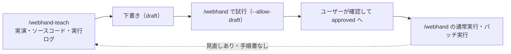
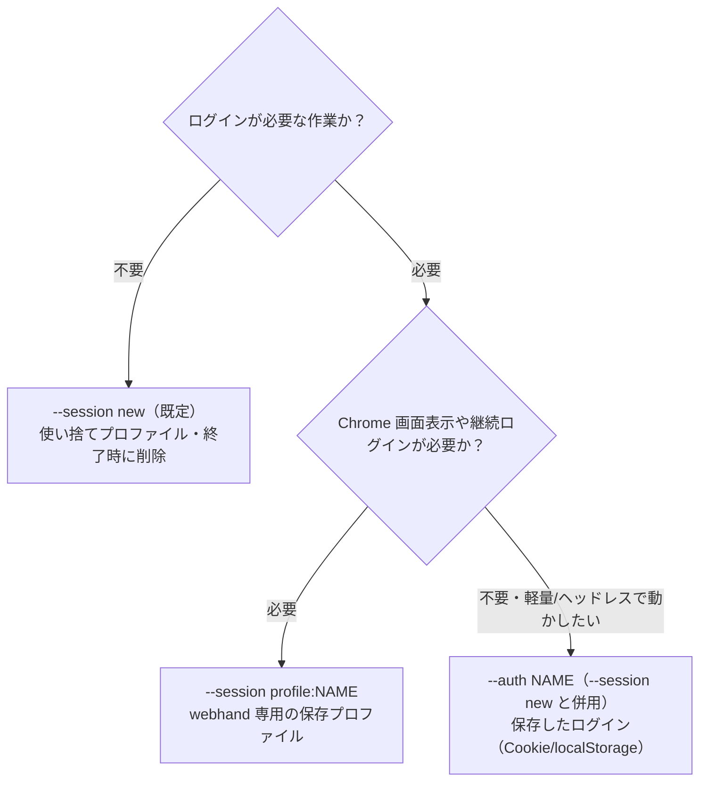

# webhand 利用ガイド

[English](usage.md) | 日本語

コーディングエージェント（**Claude Code**・**Antigravity**・**OpenAI Codex CLI** などの Agent Skills 対応ツール）から webhand を使って日々の Web 作業を任せるための、目的別の実践ガイドです。

- 初回インストールとクイックスタート: [README.ja.md](../README.ja.md#クイックスタート)
- 全 CLI コマンド・オプション・終了コード・TOML 仕様・環境変数の完全仕様: [リファレンス](reference.ja.md)
- ドキュメント全体の案内図: [docs/README.md](README.md)

---

## 1. 最初に環境を診断する

プラグイン／スキルの導入と `TYPESAFE_API_KEY` の設定（[クイックスタート](../README.ja.md#クイックスタート)）が終わったら、まず次の 2 コマンドで状態を確認します：

```bash
npx -y webhand@0.7 doctor    # Node.js >= 22・Chrome/WSL・TYPESAFE_API_KEY・環境を一括診断
npx -y webhand@0.7 catalog   # 登録済みサービス・手順書・保存プロファイル・実行中セッションを表示
```

`doctor` で `[FAIL]` が出た場合は、表示された `fix:` の手順どおりに直してから再実行してください（`npm i -g webhand` でグローバル導入すると `npx -y webhand@0.7` を省略できます）。

---

## 2. 仕事別の実践ワークフロー

Claude Code では `/webhand` のようにスラッシュコマンドで呼び出し、Antigravity や Codex ではスキル名を指定するか自然な言葉で依頼します。

### 単発の作業を任せる（`/webhand`）

```text
/webhand HOTEL PLANISPHERE で来月の第1土曜から2泊、2名で予約して
```

進み方：
1. **計画と事前確認**: エージェントが `webhand catalog` を確認し、GOAL・手順・入力値（`--value`）を計画して、足りない情報を質問します。予約・送信・購入・削除など実データを変える作業では、開始前に計画を見せて同意を取ります。
2. **セッション選択**: 使い捨ての `new`（既定）か、ログイン済みの `profile:NAME` / `--auth NAME` を選びます。
3. **操作**: Jev は観測済み要素と許可済みの値だけを使って操作します。パスワード・2FA・CAPTCHA が必要な場面では人に引き渡される（`NEEDS_HUMAN`）ので、Chrome で直接入力して完了を伝えます。
4. **実画面確認と終了**: エージェントが Jev の `GOAL_REPORTED` を鵜呑みにせず実際の画面を確認し、届かなければ最大 3 回まで見直して、結果（`status`・`attempts`・ログのパス）を 1 行で報告します。

> **まだ手順書がないサイトでも使えます。** 登録済みサービスなら `service.toml` の事実と `allowed_domains` を使って動き、初めてのサイトでも依頼内容から計画します。見直しが入った実行や手順書なしで完了した実行は、ログから `/webhand-teach <ログのパス>` で手順書化できます。

---

### CSV / JSON で複数行をまとめて処理する（`/webhand` + `webhand batch`）

**承認済み（`approved`）** の手順書を、CSV や JSON の各行に対して 1 件ずつ安全に実行します：

```text
/webhand guests.csv の各行を hotel-planisphere/reserve の手順書で処理して
```

安全なバッチ実行の流れ：
1. **ブラウザを開く前に全行を検証**: `webhand batch init --runbook SERVICE/NAME --input guests.csv` が全行を事前検査し、必須パラメータの不足、未知の列、未承認の `draft` 手順書、資格情報っぽい列名（`password`・`otp`・`cvv`・`card_number` 等）を即座に拒否します。
2. **プライバシー保護と改変検知**: 生の行データ（個人情報等）は元の CSV/JSON にのみ置き、`~/.webhand/state/batches/` には複製しません。SHA-256 ダイジェストにより、実行途中のファイル変更による行ズレも防ぎます。
3. **事前合意と 1 件ずつの確認**: バッチ概要に同意したあと、エージェントが 1 行ごとに通常の確認ループ（`start --batch ID` → `run` → 実画面確認 → `finish`）を回し、各行のステータスを自動記録します。
4. **不確実な変更は再試行しない**: `UNCERTAIN` で止まった行は `uncertain` として記録され、`start --batch` は `done` 行および `uncertain` 行の再実行を自動拒否します。
5. **進捗確認と再開**: `webhand batch status [ID] [--json]` で結果一覧表をいつでも確認でき、`webhand batch skip ID --row N` でスキップ、`webhand batch clear ID` で完了後に削除できます。

---

### 変更せずにデータを集める（`/webhand-extract`）

```text
/webhand-extract https://example.test/plans から全プランのプラン名と月額を取って plans.md に保存して
```

- `--read-only` セッションで動き、GET 以外のフォーム送信、ファイル添付、フォーム外のボタンは拒否されます（必要なボタンだけ `--allow-control "名前"` で人の承認つきで許可）。
- `webhand extract` はページの DOM（表・一覧・リンク・入力欄・本文）を直接読むため、LLM の書き写しミスが起きず、`COMPLETE` / `PARTIAL` / `INCONCLUSIVE` / `COUNT_MISMATCH` と欠落理由を明示します。
- `--format table|json|csv|markdown` と `--out PATH` を使えば、カレントディレクトリ配下へそのまま成果物ファイルとして保存できます（`..`・`.env*`・state 領域への書き込みは拒否）。

---

### 受け入れ条件の検証とリグレッション確認（`/webhand-verify`・`/webhand-regress`）

```text
/webhand-verify https://staging.example.com で次を確認して: 検索結果が価格の昇順で並ぶ / 合計に税が含まれる
/webhand-regress shop/checkout
```

- **条件の分解と環境確認**: 自然言語の条件を「前提・操作・期待」に分解して合意を取り、テスト環境か本番環境かを確認します（本番では読み取り専用の確認のみ許可）。
- **独立した判定**: Jev は操作のみを行い、エージェントが `webhand check` を使って画面引用つきで `PASS` / `FAIL` / `INCONCLUSIVE` を判定します。結果を見て期待値を緩めることはありません。
- **PR / Issue 用サマリ**: 頼めば GitHub の PR や Issue にそのまま貼れる Markdown ブロックに整形します（自動投稿はしません）。
- **回帰チェック**: 確認内容を `.webhand/checks/<service>/<name>.toml`（`draft` → 承認 → `approved`）として保存しておけば、`/webhand-regress` で前回との差分（`NEW FAIL` / `STILL FAILING` / `RECOVERED`）を検出できます。

---

### テスト環境で不具合を探す（`/webhand-explore`）

```text
/webhand-explore http://localhost:3000 の決済フォームに異常な入力を試して（許可ホスト: localhost:3000）
```

- **テスト環境専用**: 本番サイトや許可のないサイトでは実行しません。`profile:NAME` は拒否され、テスト用アカウントの `--auth NAME` のみ使えます。
- **厳格な境界制御**: `--allow-domain` 以外のホストへの通信をすべて遮断し、`--max-total-actions` で総操作数を制限します。
- **再現確認つきの候補報告**: `webhand findings` がコンソールエラー・未処理エラー・5xx・失敗リクエスト・行き止まりを収集し、エージェントが新しいセッションで再現確認したうえで報告します。

---

### サービスの使い方を教えて資産化する（`/webhand-teach`）



教え方は 3 通り：
```text
/webhand-teach --name myservice/search --url https://example.com   # 人の操作を録画して教える
/webhand-teach ./path/to/service-source                            # サービスのソースコードから作る
/webhand-teach ~/.webhand/runs/<timestamp>/adhoc.jsonl             # 過去の実行ログから覚える
```

- **スターターテンプレート活用**: [`examples/runbooks/`](../examples/runbooks/README.md)（`hotel-planisphere/`・`internal-form/`）を `.webhand/runbooks/`（Git でチーム共有）または `~/.webhand/runbooks/`（個人用）にコピーしてすぐ試せます。
- **ドメイン境界の保護**: `service.toml` に `allowed_domains = ["app.example.com"]` を書いておくと、通常実行でも許可外ドメインへの移動・リダイレクト・新規タブ遷移を自動遮断します。
- **人間向けマニュアル生成**: チーム共有用に人間向けの操作手順書（Markdown）もほしい場合は、`/webhand-teach` にあわせて依頼できます。
- **秘密情報は書かない**: パスワード・トークン・個人情報は手順書に書かず、変わる値は `params`、ログインは `[person]` ステップにします。

---

## 3. セッションとログインの選び方



| 方式 | 保持期間 | 対応エンジン | 向いている場面 |
| --- | --- | --- | --- |
| `--session new`（既定） | `finish` 時に削除 | すべて | 公開サイト、クリーン状態での検証 |
| `--session profile:NAME` | 永続（専用フォルダ） | Chrome のみ | 日常のログイン済み業務画面（`webhand profile login NAME --url ...`） |
| `--auth NAME` | `webhand auth save NAME` 時点のスナップショット | すべて（`headless-shell` 含む） | ヘッドレス実行、テスト用アカウントでの `--explore`、バッチ実行（`--id`・`profile:NAME` とは併用不可） |

> **プライバシー上の注意:** ログイン状態で開いたページの内容も Jev（TypeSafe の API）に送られます。普段使いの Chrome プロファイルには接続せず、資格情報は常に人が Chrome に直接入力します。

---

## 4. 人が直接使う CLI チートシート

普段はコーディングエージェントが CLI を呼び出しますが、次のコマンドは人が直接実行する場面があります：

```bash
webhand doctor                                              # 環境診断（Node・Chrome/WSL・APIキー・状態）
webhand catalog                                             # サービス・手順書・チェック・プロファイル・実行中セッション一覧
webhand profile login work --url https://example.com/login  # 専用保存プロファイルへの初回ログイン
webhand auth list                                           # 保存したログイン名の一覧（中身は表示しない）
webhand batch status [BATCH_ID]                             # バッチ実行の進捗と結果表を表示
webhand memory show example.com                             # flow v2 のサイト記憶を表示（`clear` で消去）
webhand record --name svc/proc --url https://example.com    # 人の操作を手動で録画
```

全 18 コマンド・全オプション・終了コード・環境変数の完全仕様は[リファレンス](reference.ja.md#コマンド)を参照してください。

---

## 5. よくあるつまずき

| 症状 | 対処 |
| --- | --- |
| 環境の何が足りないか分からない | まず `webhand doctor` を実行し、`fix:` の案内どおりに直す |
| `TYPESAFE_API_KEY` が未設定と言われる | シェルの設定ファイル（`~/.bashrc`・`~/.zshrc` 等）で export し、コーディングエージェントを再起動する（`.env` には置かない） |
| WSL で Windows 側の Chrome が使われない | `%USERPROFILE%\.wslconfig` に `networkingMode=mirrored` を設定して `wsl --shutdown` する（[WSL 設定](reference.ja.md#wsl-で-windows-側の-chrome-を使う)） |
| このリポジトリ内で `npx -y webhand@0.7` が `not found` になる | `npm run build && npm link` するか、`npx -y webhand@latest` を使う |
| `draft` の手順書が使えない | 試行のときだけ `--allow-draft` を付ける。内容確認後に `status = "approved"` へ変更する |
| `allowed_domains` で移動が拒否された | 遷移先（SSO 先を含む）のホスト名が `service.toml` の `allowed_domains` に入っているか確認する |
| 必要なフォームが観測から切れている（`0/N` や `(skip)`） | 出力の `REGIONS` を確認し、`--focus REGION` / `--skip REGION` を指定する |
| 長いページで Jev が上下スクロールを繰り返す | `--read table` / `--read list` / `--read text`、または `--compare` / `--collect` を併用する |
| 実行が `UNCERTAIN` で止まった | やみくもに再実行せず、実際の画面で変更が反映されたか目で確かめてから次を判断する |
