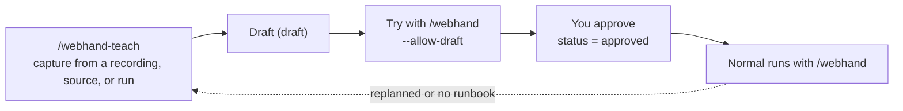

# webhand usage guide (skills and CLI)

English | [日本語](usage.ja.md)

webhand is used through coding-agent skills (Claude Code, Antigravity, Codex, and other Agent Skills-compatible agents) that call its CLI. Normally you use only the skills, and the agent runs the CLI. You use the CLI directly to manage saved profiles, to debug, and for research runs.

- Background and overview: [README.md](../README.md)
- For contributors: [DEVELOPMENT.md](../DEVELOPMENT.md)

## Setup

1. Add the plugin or skills for your coding agent.

   - **Claude Code**:

     ```text
     /plugin marketplace add sakamoto66/webhand
     /plugin install webhand@webhand
     ```

   - **Antigravity (`agy`)**:

     ```bash
     agy plugin install https://github.com/sakamoto66/webhand
     ```

   - **OpenAI Codex CLI**:

     ```bash
     codex plugin marketplace add sakamoto66/webhand
     ```

     Then open `/plugins` in Codex and install `webhand`.

   - **Other Agent Skills-compatible agents**: Copy `skills/webhand*` into your agent's skills directory (for example `.agents/skills/`).

2. Set Jev's API key as an environment variable and restart your coding agent. Do not put it in a file such as `.env`.

   ```bash
   echo 'export TYPESAFE_API_KEY=...' >> ~/.bashrc
   # To change the model: export TYPESAFE_MODEL=...
   ```

3. Check that it works. The CLI needs no installation; the skills use `npx -y webhand@0.5`. If you install it with `npm i -g webhand`, the skills use `webhand` directly and start faster.

   ```bash
   npx -y webhand@0.5 --version
   npx -y webhand@0.5 doctor
   npx -y webhand@0.5 catalog
   ```

Requirements: Node.js 22 or later and Google Chrome (on Linux, or the Windows side from WSL).

> **Note**: The content of the page being operated is sent to Jev (the TypeSafe API), including pages you are logged in to with a saved profile.

---

## Using the skills

There are six skills. In Claude Code they are invoked with `/webhand`, `/webhand-teach`, etc.; in Antigravity and Codex, activate them by skill name or ask in plain words.

| Skill | Purpose |
| --- | --- |
| `/webhand` | Get something done on a web page |
| `/webhand-teach` | Teach webhand how a service works and write its service information and runbooks |
| `/webhand-regress` | Re-run saved checks and report what newly broke since the last run |
| `/webhand-explore` | Look for faults in a test environment: console errors, uncaught errors, 5xx, failed requests and dead ends, as candidates with the steps that led to them |
| `/webhand-extract` | Read data from a page without changing anything (a table, a list, links), with the count and what could not be read |
| `/webhand-verify` | Check acceptance criteria on a real page and report PASS / FAIL / INCONCLUSIVE with quoted evidence |

### Typical flow



### `/webhand` — ask for something

```text
/webhand On HOTEL PLANISPHERE, book 2 nights for 2 people starting next month's first Saturday
```

The agent proceeds in this order.

1. **Plan**: Reads known services and runbooks with `webhand catalog`, and decides the GOAL, start URL, steps, and input values.
   - It asks you for missing values. It never makes up personal data.
   - It never asks for passwords, verification codes, or card numbers; those become `[person]` steps (done by a person).
   - For anything that changes real data (booking, sending, purchasing, deleting), it shows the plan and asks for your agreement before starting.
2. **Choose a session**: Unless your request says, you are asked for one of these.
   - `new` (default): a throwaway profile. Starts signed out and is deleted at the end.
   - `profile:NAME`: a saved profile dedicated to webhand. It keeps you signed in. The agent offers to create one if needed.
3. **Run**: Jev operates toward the GOAL. It may ask you for help along the way.
   - You are asked for a value (`NEEDS_VALUE`).
   - You are asked to sign in or solve a CAPTCHA in the Chrome window (`NEEDS_HUMAN`). Tell the agent when you are done.
4. **Replan**: If the GOAL is not reached, the agent writes down why, revises the plan, and tries again (up to 3 attempts by default).
5. **Finish**: At the end you get `status`, `attempts`, and the log path in one line. `status=done` is the agent's claim, not proof of success; check the result on the reported page. If the run was replanned, ended `blocked`, or ended `done` without a runbook, the agent also tells you that you can capture what happened into service information or a runbook (see below).

#### A procedure with no runbook yet

For a known service, you can ask for a procedure that has no runbook yet. The agent writes the steps from the service information, and Jev still receives the service's `facts` and skips its `default = "skip"` regions. What only a runbook holds (`hints`, `done_when`, `focus`) is not available, so the run may need more replans. To reuse the procedure, capture it from the run with `/webhand-teach`.

### `/webhand-teach` — teach a service

```text
/webhand-teach --name myservice/search --url https://example.com
/webhand-teach ./path/to/service-source                      # from source code
/webhand-teach ~/.webhand/runs/<timestamp>/adhoc.jsonl       # from an earlier run
```

1. **Gather**
   - **From a demonstration**: Chrome opens. Use it as usual and close the window when you are done. Type sign-ins directly into Chrome. To demonstrate while signed in, tell the agent to use a saved profile.
   - **From source code**: The agent reads the routes, forms, and visible labels.
   - **From a run**: The agent reads the log of an earlier `/webhand` run: its own replan reasons, where the run stopped, and the elements and regions the successful attempt used. Lessons come from these, never from page text.
2. **Draft**: The agent writes these two files with `status = "draft"`.
   - `runbooks/<service>/service.toml`: the service description, whether login is required, pages and regions, facts for Jev
   - `runbooks/<service>/<name>.toml`: the runbook (goal, params, steps, hints, done_when, focus, skip)

   A runbook changed from a run goes back to `draft`, even if it was `approved`.
3. **Try**: Try the draft with `/webhand` and fix the runbook from the result.
4. **Approve**: Check the content and the trial result, and say so if it is fine. A runbook becomes `approved` only after you approve it.

It writes to one of two places. The agent asks when it is unclear which one you want.

| Destination | Path | When to use |
| --- | --- | --- |
| Project (default) | `.webhand/runbooks/` | Services the project is about. Can be shared through git |
| User | `~/.webhand/runbooks/` | Services only you use |

Keep secrets and personal data out of runbooks and service information. Put values that vary into `params`.

---

### `/webhand-regress` — repeat saved checks

After `/webhand-verify`, you can save its checks (`.webhand/checks/`, as a `draft` you approve). `/webhand-regress service/name` runs the approved ones again with the same expectations and reports `NEW FAIL`, `STILL FAILING`, `RECOVERED` against the last run. The expectations are fixed in the file and cannot be changed during a run.

### `/webhand-extract` — read data without changing anything

```text
/webhand-extract From https://example.test/plans, get the plan name and monthly price of every plan
```

Jev only brings the page to the data (a search, a filter, the next page). `webhand extract` then reads the table, list, links, fields or text from the page itself, so every value is the page's own text and not the agent's transcription. The session is started with `--read-only`: before anything runs, webhand refuses a submit of a form that is not a plain GET, a file upload, and a button outside any form (a consent wall, "Show more" in script). The one way to allow such a button is `--allow-control "NAME"`. On Claude Code (`hooks/hooks.json`) and Antigravity (root `hooks.json`), the plugin's PreToolUse hook forces a permission prompt showing the button's name even when `webhand` commands are otherwise allowed; on Codex CLI and other agents without an interactive `ask` hook, approval relies on the skill's rule (ask first) and the agent's own command approval mode. The agent also asks first and reads the actions that ran. webhand refuses only what it can classify: a link or a script that changes something is not told apart.

For a table, `--rows raw` (the default) shows every row and marks a row that is one cell spanning the whole table (a footnote or a section title); `--rows data` leaves those rows out and names them.

The report is a table with the URL, the time, the count, and what could not be read. `webhand extract` ends `COMPLETE`, `PARTIAL` (a missing column, merged cells expanded, hidden rows left out, a frame or canvas it cannot read), `INCONCLUSIVE` (still loading, nothing found) or `COUNT_MISMATCH` (against `--expect-count`). It never fills in a gap.

### `/webhand-explore` — look for faults in a test environment

```text
/webhand-explore Try abnormal input on the checkout form of http://localhost:3000 (allowed host: localhost:3000)
```

You give a charter (what to try) and the hosts that may be visited; the agent shows them and asks you to confirm before it starts. The session is started with `start --explore --allow-domain HOST --max-total-actions N`: webhand refuses `profile:NAME`, refuses every request to a host outside the list (links to other sites, third-party scripts), and stops at the action limit for the whole session. If the app needs a login, use `--auth NAME` with a login saved from a **test account** (signed-in pages are sent to Jev); `--file` lets Jev upload a test file. Jev operates; webhand notes console errors, uncaught errors, 5xx responses, failed requests and dead ends, and `webhand findings` lists them with the steps that led to them.

A finding is a candidate, not a verdict. The agent repeats the steps of each one in a new session and reports it as confirmed, not reproduced or not tried. Exploring submits forms in the test system and may create data: use it only where that is acceptable.

### `/webhand-verify` — check acceptance criteria

```text
/webhand-verify On https://staging.example.com, check: results are sorted by price ascending / the total includes tax
/webhand-verify Check the acceptance criteria of issue #123 on https://staging.example.com
```

1. **Split**: The agent turns the criteria into checks (precondition, operation, expected result), shows the list, and gets your agreement. Criteria with nothing observable on the page ("feels fast") are left out.
2. **Environment**: it always asks whether the URL is a test environment or a real service. On a real service it runs only checks that change nothing; checks that register, send, buy or delete are not run (`INCONCLUSIVE`).
3. **Operate**: one new session per check; Jev only operates. Jev's completion report (`GOAL_REPORTED`) is never evidence of a pass.
4. **Judge**: after the operation, the agent reads the page and compares it with the expected result.

| Verdict | Meaning |
| --- | --- |
| `PASS` | The operation was carried out as the check says, and the page shows the expected result (quoted) |
| `FAIL` | The operation was carried out as the check says, and the page shows something else (expected, seen, and the operations that ran) |
| `INCONCLUSIVE` | The operation did not get done, or was not run. It is not treated as a product failure |

Nothing is loosened after the result is seen. The overall result is `ACCEPT` only when every check is `PASS`; any `FAIL` is `REJECT`; a leftover `INCONCLUSIVE` is `NOT CONFIRMED`. Posting to an issue or PR happens only when you ask.

---

## Using the CLI

If it is not installed, read `webhand` as `npx -y webhand@0.5`. See `webhand COMMAND --help` for each command's details.

### Commands

| Command | Owner | What it does |
| --- | --- | --- |
| `catalog` | Agent | List known services, runbooks, and saved profiles |
| `doctor` | Person | Check Node.js, Chrome, `TYPESAFE_API_KEY`, and local workspace readiness |
| `start` | Agent | Record the plan and open the start URL in Chrome |
| `run` | Jev | Operate toward the GOAL |
| `replan` | Agent | Revise the plan and start the next attempt |
| `act` | Agent | Run one operation in place of Jev |
| `observe` | Agent | Print the current page |
| `finish` | Agent | Write the log and close Chrome |
| `record` | Person | Record a person's demonstration (legacy alias: `learn`) |
| `memory` | Person | Show or forget site memory from earlier runs (legacy alias: `knowledge`) |
| `profile` | Person | Manage saved profiles |

### Run flow

```bash
webhand catalog
webhand start --goal "..." --url "https://..." --step "..." --value "Name=..." --session new
webhand run
# Depending on the outcome: run --value / run --human-done / replan / act
webhand finish --status done --reason "..."
```

One run goes from `start` to `finish`. Always run `finish` exactly once, even after a failure.

### `start`

| Option | Meaning |
| --- | --- |
| `--goal G` | The GOAL. Include every requirement and value, and end with "Stop when ... is shown" |
| `--url U` | Start URL |
| `--step S` (repeatable) | A step. `"[person] ..."` is done by a person (needs `--headed`) |
| `--value LABEL=VALUE` (repeatable) | A value Jev may type |
| `--service NAME` | Service information passed to Jev (e.g. `hotel-site`), with or without a runbook |
| `--runbook NAME` | A runbook (e.g. `hotel/filter`). Its GOAL, start URL, and steps become the defaults |
| `--param KEY=VALUE` (repeatable) | A runbook parameter. Passed to Jev as an input value |
| `--allow-draft` | Try an unapproved (draft) runbook |
| `--focus REGION` / `--skip REGION` (repeatable) | Regions to show first / to leave out (e.g. `form:Reservation`) |
| `--read KIND` (repeatable) | Content to read from beyond the viewport: `outline`, `text`, `table`, `list`, `link`, `control`, `media`. See the reference |
| `--session new\|profile:NAME` | The session. Default `new` |
| `--chrome auto\|linux\|windows` | Which Chrome. Default `auto` (also `WEBHAND_CHROME`) |
| `--headed` | Show the Chrome window |
| `--max-attempts N` | Attempt limit. Default 3 |
| `--max-actions N` / `--max-decisions N` | Per-attempt limits on actions / decisions. Default 30 / 60 |

With a runbook:

```bash
webhand start --runbook hotel/reserve --param date=2026-12-05 --param guests=2 --session profile:work --headed
```

### `run`

```bash
webhand run
webhand run --value "Phone=..."   # answer NEEDS_VALUE (adds or replaces a value)
webhand run --human-done          # the work for NEEDS_HUMAN is done
```

`run` stops with one of these.

| Outcome | Meaning | Next |
| --- | --- | --- |
| `GOAL_REPORTED` | Jev reported the GOAL reached | Check the page against the GOAL, then `finish --status done` or `replan` |
| `NEEDS_VALUE` | No value in the plan fits a field | `run --value "LABEL=VALUE"` |
| `NEEDS_HUMAN` | Sign-in, a verification code, a CAPTCHA, or a `[person]` step | A person does it in Chrome, then `run --human-done` |
| `BLOCKED` / `STUCK` / `ATTEMPT_BUDGET` | It cannot go on | `replan`, one `act`, or `finish` |
| `JEV_FAILED` | Jev's response was unusable (nothing ran) | `run` again. If it repeats, `replan` or `act` |
| `UNCERTAIN` | Unknown whether an action took effect | Do not repeat it; `finish --status error` |

### `replan`

```bash
webhand replan --reason "The search button was never pressed" --step "..." --restart
```

| Option | Meaning |
| --- | --- |
| `--reason R` (required) | Why the last attempt fell short. Jev sees it too |
| `--step S` (repeatable) | Replace the steps |
| `--value LABEL=VALUE` (repeatable) | Add or replace values |
| `--focus` / `--skip` | Replace the region choice |
| `--read KIND` | Replace what is read beyond the viewport; `--read none` turns it off |
| `--restart` | Open the start URL again before the next attempt. Do not use after something was submitted on a real service |

It is refused once the attempt limit is reached; then finish with `finish --status blocked`.

### `act` and `observe`

```bash
webhand observe                         # print the current page
webhand act CLICK 3
webhand act TYPE_TEXT 2 --text "Lisbon"
webhand act SELECT 4:2
webhand act SCROLL_DOWN                 # also SCROLL_UP, WAIT
```

The numbers are element numbers from the latest output. `STALE` means the page changed and nothing ran; decide again from the new output.

### `finish`

```bash
webhand finish --status done|blocked|budget|error|abandoned [--reason R]
```

Writes the log and closes Chrome. Give the visible evidence (for `done`) or why it ended in `--reason`. `done` is a claim, not proof of success. `run_end.verified` is `null` because there is no independent verifier (independent verification of research tasks happens only through `/webhand-research` in the research repository; see `DEVELOPMENT.md`).

### `record`

```bash
webhand record --name myservice/search --url https://example.com [--scope project|user] [--session profile:NAME] [--max-minutes 30]
```

Opens Chrome and records what a person does. Closing the window ends it; it prints the record's path and where to write the service information and runbook (`WRITE THE RUNBOOK TO ...`).

- Keystrokes are not recorded. Values of password and similar fields become `<redacted>`, and URL query values are masked. Values of fields it cannot recognize remain in the record.
- Records contain page text, so do not share them.
- Actions inside iframes and file pickers are kept as `unsupported`. A new tab is recorded as a `tab` event, and the runbook gets a step that switches to it.

### `profile`

```bash
webhand profile login work --url https://example.com/login   # a person signs in and closes the window
webhand profile list
webhand profile delete work
```

Saved profiles are dedicated to webhand. webhand never connects to your everyday Chrome profile.

| OS | Location |
| --- | --- |
| Linux | `~/.webhand/state/profiles/` |
| Windows | `%LOCALAPPDATA%\webhand\profiles\` |

---

## Storage and environment variables

| Location | Contents |
| --- | --- |
| `.webhand/runbooks/` (project) | The project's service information and runbooks. Wins over the user's of the same name |
| `~/.webhand/runbooks/` (user) | Service information and runbooks used in every project |
| `~/.webhand/memory/` | Site memory remembered by flow v2 from earlier runs (per host, no typed values; migrates any legacy `~/.webhand/knowledge/` automatically) |
| `~/.webhand/runs/` | Run and demonstration logs (JSONL). Demonstration records contain page text; run logs keep value labels, not typed values. With `WEBHAND_SCREENSHOTS=1`, screenshots go beside the run log and show typed values |
| `~/.webhand/state/` | Active sessions and saved profiles |

| Variable | Meaning |
| --- | --- |
| `TYPESAFE_API_KEY` | Jev's API key (required) |
| `TYPESAFE_MODEL` | The model Jev uses |
| `WEBHAND_HOME` | The per-user location (default `~/.webhand`) |
| `WEBHAND_CHROME` | `auto` / `linux` / `windows` |
| `WEBHAND_FLOW` | Default flow of `start`: `v2` (default) or `v1` |
| `WEBHAND_MEMORY` | `0` turns off what flow v2 remembers about sites and offers to Jev; `WEBHAND_MEMORY_USE=0` stops only the offering (legacy `WEBHAND_KNOWLEDGE` / `WEBHAND_KNOWLEDGE_USE` also work) |
| `WEBHAND_SCREENSHOTS` | `1` saves a PNG of the page at start, after each action, and after a restart beside the run log (`<log>-screenshots/`), for scoring a run outside webhand. Typed values show in the images. Never sent to Jev |

## Using Windows Chrome from WSL

`--chrome auto` uses the Windows `chrome.exe` when it can connect to it. WSL networking must be mirrored.

```ini
# %USERPROFILE%\.wslconfig
[wsl2]
networkingMode=mirrored
```

Then run `wsl --shutdown` in PowerShell to restart WSL.

## Common pitfalls

| Symptom | Fix |
| --- | --- |
| Told that `TYPESAFE_API_KEY` is not set | Set the environment variable in your shell profile and restart your coding agent |
| `npx -y webhand@0.5` says `webhand: not found` inside this repository | Run `npm run build && npm link`, or use `npx -y webhand@latest` |
| A draft runbook cannot be used | Add `--allow-draft` only for trials. Normal runs need approval |
| A needed part of the page is cut from the observation | Check `REGIONS` in the output for `0/N` or `(skip)`, and pass `--focus` / `--skip` |
| Jev scrolls up and down on a long page, looking for something | Pass `--read` with the kinds the goal needs, such as `--read table` |
| The same kind of failure keeps happening | Capture what happened into service info or a runbook with `/webhand-teach <log>` so the next plan benefits |
