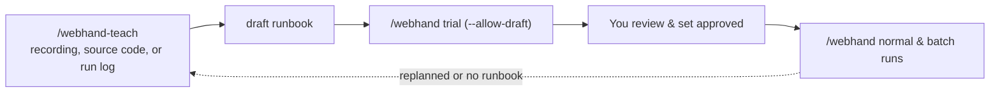
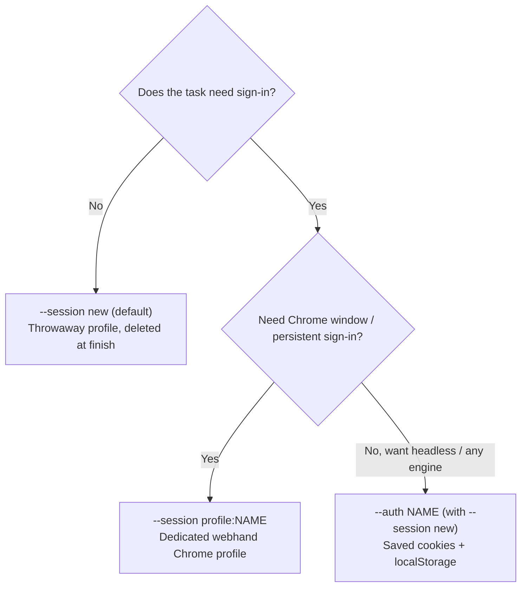

# webhand usage guide

English | [日本語](usage.ja.md)

Task-oriented workflows for delegating browser work through your coding agent (**Claude Code**, **Antigravity**, **OpenAI Codex CLI**, or any Agent Skills-compatible tool).

- First-time install & setup: [README.md](../README.md#quick-start)
- Complete CLI, option, schema, engine, and environment-variable spec: [Reference](reference.md)
- All docs index: [docs/README.md](README.md)

---

## 1. Verify your setup first

After installing the plugin/skills and exporting `TYPESAFE_API_KEY` (see [Quick start](../README.md#quick-start)), run one check:

```bash
npx -y webhand@latest doctor    # checks Node.js >= 22, Chrome/WSL, TYPESAFE_API_KEY, and workspace
npx -y webhand@latest catalog   # lists saved services, runbooks, profiles, and active sessions
```

If `doctor` prints `[FAIL]`, follow its `fix:` line before starting a run. (Install globally with `npm i -g webhand` to drop the `npx -y webhand@latest` prefix.)

---

## 2. Workflows by job

In Claude Code, invoke skills with `/webhand`, `/webhand-extract`, etc. In Antigravity and Codex, mention the skill name or describe the job in plain language.

### Delegate a single task (`/webhand`)

```text
/webhand On HOTEL PLANISPHERE, book 2 nights for 2 people starting next month's first Saturday
```

What happens:
1. **Plan & confirm**: Your agent checks `webhand catalog`, builds the GOAL, steps, and explicit `--value` inputs, and asks for any missing information. Before making real changes (booking, submitting, purchasing, deleting), it shows the plan and asks your agreement.
2. **Choose session**: Pick a throwaway `new` session (default) or a dedicated saved sign-in (`profile:NAME` or `--auth NAME`).
3. **Operate**: Jev picks clicks and entries from observed page elements and your listed values only. If a password, 2FA code, or CAPTCHA appears, Chrome hands control to you (`NEEDS_HUMAN`); type directly in Chrome and tell the agent when done.
4. **Verify & finish**: Your agent inspects the actual final page (never trusting Jev's `GOAL_REPORTED` alone), replans up to 3 times if needed, and finishes with a 1-line summary (`status`, `attempts`, `log`).

> **No runbook yet?** Even without a saved runbook, webhand works on known services (using `service.toml` facts and `allowed_domains`) and brand-new sites. If a run needed replanning or succeeded without a runbook, teach webhand from its log with `/webhand-teach <log path>`.

---

### Run a CSV or JSON batch (`/webhand` + `webhand batch`)

Repeat an **approved** runbook safely across multiple rows of a `.csv` or `.json` file:

```text
/webhand Run hotel-planisphere/reserve for every row in guests.csv
```

How the safe batch workflow runs:
1. **Validate upfront**: `webhand batch init --runbook SERVICE/NAME --input guests.csv` checks every row before any browser opens — rejecting missing required params, unknown columns, unapproved `draft` runbooks, and credential-like columns (`password`, `otp`, `cvv`, `card_number`, etc.).
2. **Privacy & drift guard**: Raw row values stay only in your CSV/JSON file (never copied into `~/.webhand/state/batches/`). A SHA-256 digest detects if the file changes mid-batch.
3. **Consent once, verify every row**: After you approve the batch summary, the agent runs each row through the normal loop (`start --batch ID` → `run` → verify actual page → `finish`), updating row status automatically.
4. **Never retry uncertain mutations**: Any row that ends `UNCERTAIN` is recorded as `uncertain`, and `start --batch` refuses to re-run `done` or `uncertain` rows.
5. **Resume & report**: Inspect progress anytime with `webhand batch status [ID] [--json]`, skip a row with `webhand batch skip ID --row N`, and clean up with `webhand batch clear ID`.

---

### Extract data read-only (`/webhand-extract`)

```text
/webhand-extract Read all plan names and monthly prices from https://example.test/plans and save as plans.md
```

- Runs in a `--read-only` session: non-GET form submits, file uploads, and buttons outside forms are refused unless you explicitly approve `--allow-control "Name"`.
- `webhand extract` reads the DOM directly (tables, lists, links, fields, text) — never paraphrased by an LLM — and reports `COMPLETE`, `PARTIAL`, `INCONCLUSIVE`, or `COUNT_MISMATCH`.
- Export deliverables directly with `--format table|json|csv|markdown` and `--out PATH` (writes safely inside the current directory only; refuses `..`, `.env*`, and webhand state).

---

### Check acceptance criteria & catch regressions (`/webhand-verify`, `/webhand-regress`)

```text
/webhand-verify On https://staging.example.com, check: results sort by price ascending / total includes tax
/webhand-regress shop/checkout
```

- **Decompose & confirm**: The agent turns natural-language criteria into observable checks (`Given / Steps / Expected`) and confirms whether the target is a test or production environment (production allows read-only checks only).
- **Independent judgment**: Jev performs the operation; the agent checks the page using `webhand check` and reports `PASS`, `FAIL`, or `INCONCLUSIVE` with quoted on-page evidence — never loosening expectations after seeing the page.
- **PR-ready summary**: Ask the agent for a PR/Issue-ready Markdown block if you want to paste results into GitHub (it never posts automatically).
- **Regression reuse**: Save checks as `.webhand/services/<service>/checks/<name>.toml` (`draft` → you approve → `approved`) and re-run them with `/webhand-regress` to see `NEW FAIL`, `STILL FAILING`, and `RECOVERED`.

---

### Hunt for bugs in a test environment (`/webhand-explore`)

```text
/webhand-explore Try invalid inputs on http://localhost:3000/checkout (allow: localhost:3000)
```

- **Test environments only**: Never run on production or a site you do not have permission to test. `profile:NAME` is refused; only a test-account `--auth NAME` is permitted.
- **Strict boundary**: Every request outside `--allow-domain` is aborted, and `--max-total-actions` caps the session.
- **Reproduced candidates**: `webhand findings` collects console errors, uncaught errors, 5xx responses, failed requests, and dead ends. The agent repeats each candidate in a fresh session and reports whether it reproduced.

---

### Teach a service & share runbooks (`/webhand-teach`)



Three ways to teach:
```text
/webhand-teach --name myservice/search --url https://example.com   # from a live recording
/webhand-teach ./path/to/service-source                            # from source code
/webhand-teach ~/.webhand/runs/<timestamp>/adhoc.jsonl             # from an earlier run log
```

- **Starter templates**: Copy and adapt an example from [`examples/services/`](../examples/services/README.md) (`hotel-planisphere/` or `internal-form/`) into `.webhand/services/` (project-shared via Git) or `~/.webhand/services/` (personal).
- **Domain boundary**: Add `allowed_domains = ["app.example.com"]` to `service.toml` so normal runs refuse navigations, redirects, and new tabs outside your service's hosts.
- **Human-readable SOP**: Ask `/webhand-teach` to also produce a Markdown guide from the approved runbook when your team wants human documentation alongside the TOML.
- **Never store secrets**: Keep passwords, tokens, and personal data out of runbooks; pass changing inputs via `params` and mark login steps as `[person]`.

---

## 3. Choosing a session & login strategy



| Mode | Persistence | Engines | Best for |
| --- | --- | --- | --- |
| `--session new` (default) | Deleted on `finish` | All | Public sites, clean-state tests |
| `--session profile:NAME` | Persistent webhand profile | Chrome only | Daily signed-in workflows (`webhand profile login NAME --url ...`) |
| `--auth NAME` | Snapshot of cookies/localStorage (`webhand auth save NAME`) | All (including `headless-shell`) | Headless runs, `--explore` with a test account, batch runs (cannot combine with `--id` or `profile:NAME`) |

> **Privacy reminder:** Pages viewed while signed in are sent to Jev (the TypeSafe API). webhand never connects to your everyday Chrome profile, and you always type credentials directly in Chrome.

---

## 4. Direct CLI cheat sheet (for people)

Normally your coding agent invokes the CLI for you. These are the commands people commonly run directly:

```bash
webhand doctor                                            # diagnose Node, Chrome/WSL, API key, workspace
webhand catalog                                           # list services, runbooks, checks, profiles, sessions
webhand profile login work --url https://example.com/login # sign in once to a dedicated webhand profile
webhand auth list                                         # list saved login snapshots (never prints contents)
webhand batch status [BATCH_ID]                           # inspect multi-row batch progress & result table
webhand memory show example.com                           # inspect or `clear` local flow-v2 site memory
webhand record --name svc/proc --url https://example.com  # record a demonstration manually
```

For all 18 CLI commands, options, exit codes, and environment variables, see [Reference](reference.md#commands).

---

## 5. Common pitfalls

| Symptom | Fix |
| --- | --- |
| Setup issue or unsure what is missing | Run `webhand doctor` and follow its `fix:` lines |
| `TYPESAFE_API_KEY` is not set | Export it in your shell profile (`~/.bashrc`, `~/.zshrc`) and restart your coding agent; never put it in `.env` |
| On WSL, Windows Chrome is not used | Enable `networkingMode=mirrored` in `%USERPROFILE%\.wslconfig` and run `wsl --shutdown` ([WSL setup](reference.md#using-windows-chrome-from-wsl)) |
| Inside this repo, the skills' `npx -y webhand@<version>` says `not found` | Run `npm run build && npm link`, or use `npx -y webhand@latest` |
| Runbook is refused as `draft` | Trial once with `--allow-draft`; set `status = "approved"` only after reviewing |
| Navigation refused by `allowed_domains` | Verify the host (and any SSO host) is listed in `service.toml`'s `allowed_domains` |
| Needed form/controls cut off (`0/N` or `(skip)`) | Check `REGIONS` in output and pass `--focus REGION` or `--skip REGION` |
| Jev scrolls endlessly on a long page | Add `--read table` / `--read list` / `--read text`, or use `--compare` / `--collect` |
| A run ended `UNCERTAIN` | Do not retry blindly — check the real page to see whether the change happened before deciding what to do next |
