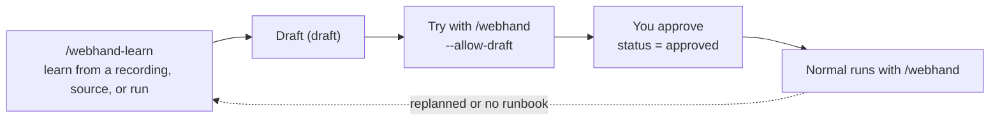

# webhand usage guide (skills and CLI)

English | [日本語](usage.ja.md)

webhand is used through Claude Code skills that call its CLI. Normally you use only the skills, and Claude runs the CLI. You use the CLI directly to manage saved profiles, to debug, and for research runs.

- Background and overview: [README.md](../README.md)
- For contributors: [DEVELOPMENT.md](../DEVELOPMENT.md)

## Setup

1. Add the plugin (in Claude Code).

   ```text
   /plugin marketplace add sakamoto66/webhand
   /plugin install webhand@webhand
   ```

2. Set Jev's API key as an environment variable and restart Claude Code. Do not put it in a file such as `.env`.

   ```bash
   echo 'export TYPESAFE_API_KEY=...' >> ~/.bashrc
   # To change the model: export TYPESAFE_MODEL=...
   ```

3. Check that it works. The CLI needs no installation; the skills use `npx -y webhand@0.3`. If you install it with `npm i -g webhand`, the skills use `webhand` directly and start faster.

   ```bash
   npx -y webhand@0.3 --version
   npx -y webhand@0.3 catalog
   ```

Requirements: Node.js 22 or later and Google Chrome (on Linux, or the Windows side from WSL).

> **Note**: The content of the page being operated is sent to Jev (the TypeSafe API), including pages you are logged in to with a saved profile.

---

## Using the skills

There are two skills.

| Skill | Purpose |
| --- | --- |
| `/webhand` | Get something done on a web page |
| `/webhand-learn` | Learn how to use a service and write its service information and runbooks |

### Typical flow



### `/webhand` — ask for something

```text
/webhand On HOTEL PLANISPHERE, book 2 nights for 2 people starting next month's first Saturday
```

Claude proceeds in this order.

1. **Plan**: Reads the learned services and runbooks with `webhand catalog`, and decides the GOAL, start URL, steps, and input values.
   - It asks you for missing values. It never makes up personal data.
   - It never asks for passwords, verification codes, or card numbers; those become `[person]` steps (done by a person).
   - For anything that changes real data (booking, sending, purchasing, deleting), it shows the plan and asks for your agreement before starting.
2. **Choose a session**: Unless your request says, you are asked for one of these.
   - `new` (default): a throwaway profile. Starts signed out and is deleted at the end.
   - `profile:NAME`: a saved profile dedicated to webhand. It keeps you signed in. Claude offers to create one if needed.
3. **Run**: Jev operates toward the GOAL. It may ask you for help along the way.
   - You are asked for a value (`NEEDS_VALUE`).
   - You are asked to sign in or solve a CAPTCHA in the Chrome window (`NEEDS_HUMAN`). Tell Claude when you are done.
4. **Replan**: If the GOAL is not reached, Claude writes down why, revises the plan, and tries again (up to 3 attempts by default).
5. **Finish**: At the end you get `status`, `attempts`, and the log path in one line. `status=done` is Claude's claim, not proof of success; check the result on the reported page. If the run was replanned, ended `blocked`, or ended `done` without a runbook, Claude also tells you that you can learn from it (see below).

#### A procedure not learned yet

For a service webhand has learned, you can ask for a procedure that has no runbook yet. Claude writes the steps from the service information, and Jev still receives the service's `facts` and skips its `default = "skip"` regions. What only a runbook holds (`hints`, `done_when`, `focus`) is not available, so the run may need more replans. To reuse the procedure, learn it from the run.

### `/webhand-learn` — teach a service

```text
/webhand-learn --name myservice/search --url https://example.com
/webhand-learn ./path/to/service-source                      # from source code
/webhand-learn ~/.webhand/runs/<timestamp>/adhoc.jsonl       # from an earlier run
```

1. **Gather**
   - **From a demonstration**: Chrome opens. Use it as usual and close the window when you are done. Type sign-ins directly into Chrome. To demonstrate while signed in, tell Claude to use a saved profile.
   - **From source code**: Claude reads the routes, forms, and visible labels.
   - **From a run**: Claude reads the log of an earlier `/webhand` run: its own replan reasons, where the run stopped, and the elements and regions the successful attempt used. Lessons come from these, never from page text.
2. **Draft**: Claude writes these two files with `status = "draft"`.
   - `runbooks/<service>/service.toml`: the service description, whether login is required, pages and regions, facts for Jev
   - `runbooks/<service>/<name>.toml`: the runbook (goal, params, steps, hints, done_when, focus, skip)

   A runbook changed from a run goes back to `draft`, even if it was `approved`.
3. **Try**: Try the draft with `/webhand` and fix the runbook from the result.
4. **Approve**: Check the content and the trial result, and say so if it is fine. A runbook becomes `approved` only after you approve it.

It writes to one of two places. Claude asks when it is unclear which one you want.

| Destination | Path | When to use |
| --- | --- | --- |
| Project (default) | `.webhand/runbooks/` | Services the project is about. Can be shared through git |
| User | `~/.webhand/runbooks/` | Services only you use |

Keep secrets and personal data out of runbooks and service information. Put values that vary into `params`.

---

## Using the CLI

If it is not installed, read `webhand` as `npx -y webhand@0.3`. See `webhand COMMAND --help` for each command's details.

### Commands

| Command | Owner | What it does |
| --- | --- | --- |
| `catalog` | Claude | List learned services, runbooks, and saved profiles |
| `start` | Claude | Record the plan and open the start URL in Chrome |
| `run` | Jev | Operate toward the GOAL |
| `replan` | Claude | Revise the plan and start the next attempt |
| `act` | Claude | Run one operation in place of Jev |
| `observe` | Claude | Print the current page |
| `finish` | Claude | Write the log and close Chrome |
| `learn` | Person | Record a person's demonstration |
| `profile` | Person | Manage saved profiles |

### Run flow

```bash
webhand catalog
webhand start --goal "..." --url "https://..." --step "..." --value "Name=..." --session new
webhand run
# Depending on the outcome: run --value / run --human-done / replan / act
webhand finish --status done --reason "..."
```

One run goes from `start` to `finish`. Always run `finish` exactly once, even after a failure.

### `start`

| Option | Meaning |
| --- | --- |
| `--goal G` | The GOAL. Include every requirement and value, and end with "Stop when ... is shown" |
| `--url U` | Start URL |
| `--step S` (repeatable) | A step. `"[person] ..."` is done by a person (needs `--headed`) |
| `--value LABEL=VALUE` (repeatable) | A value Jev may type |
| `--service NAME` | Service information passed to Jev (e.g. `hotel-site`), with or without a runbook |
| `--runbook NAME` | A runbook (e.g. `hotel/filter`). Its GOAL, start URL, and steps become the defaults |
| `--param KEY=VALUE` (repeatable) | A runbook parameter. Passed to Jev as an input value |
| `--allow-draft` | Try an unapproved (draft) runbook |
| `--focus REGION` / `--skip REGION` (repeatable) | Regions to show first / to leave out (e.g. `form:Reservation`) |
| `--session new\|profile:NAME` | The session. Default `new` |
| `--chrome auto\|linux\|windows` | Which Chrome. Default `auto` (also `WEBHAND_CHROME`) |
| `--headed` | Show the Chrome window |
| `--max-attempts N` | Attempt limit. Default 3 |
| `--max-actions N` / `--max-decisions N` | Per-attempt limits on actions / decisions. Default 30 / 60 |

With a runbook:

```bash
webhand start --runbook hotel/reserve --param date=2026-12-05 --param guests=2 --session profile:work --headed
```

### `run`

```bash
webhand run
webhand run --value "Phone=..."   # answer NEEDS_VALUE (adds or replaces a value)
webhand run --human-done          # the work for NEEDS_HUMAN is done
```

`run` stops with one of these.

| Outcome | Meaning | Next |
| --- | --- | --- |
| `GOAL_REPORTED` | Jev reported the GOAL reached | Check the page against the GOAL, then `finish --status done` or `replan` |
| `NEEDS_VALUE` | No value in the plan fits a field | `run --value "LABEL=VALUE"` |
| `NEEDS_HUMAN` | Sign-in, a verification code, a CAPTCHA, or a `[person]` step | A person does it in Chrome, then `run --human-done` |
| `BLOCKED` / `STUCK` / `ATTEMPT_BUDGET` | It cannot go on | `replan`, one `act`, or `finish` |
| `JEV_FAILED` | Jev's response was unusable (nothing ran) | `run` again. If it repeats, `replan` or `act` |
| `UNCERTAIN` | Unknown whether an action took effect | Do not repeat it; `finish --status error` |

### `replan`

```bash
webhand replan --reason "The search button was never pressed" --step "..." --restart
```

| Option | Meaning |
| --- | --- |
| `--reason R` (required) | Why the last attempt fell short. Jev sees it too |
| `--step S` (repeatable) | Replace the steps |
| `--value LABEL=VALUE` (repeatable) | Add or replace values |
| `--focus` / `--skip` | Replace the region choice |
| `--restart` | Open the start URL again before the next attempt. Do not use after something was submitted on a real service |

It is refused once the attempt limit is reached; then finish with `finish --status blocked`.

### `act` and `observe`

```bash
webhand observe                         # print the current page
webhand act CLICK 3
webhand act TYPE_TEXT 2 --text "Lisbon"
webhand act SELECT 4:2
webhand act SCROLL_DOWN                 # also SCROLL_UP, WAIT
```

The numbers are element numbers from the latest output. `STALE` means the page changed and nothing ran; decide again from the new output.

### `finish`

```bash
webhand finish --status done|blocked|budget|error|abandoned [--reason R]
```

Writes the log and closes Chrome. Give the visible evidence (for `done`) or why it ended in `--reason`. `done` is a claim, not proof of success. `run_end.verified` is `null` because there is no independent verifier (independent verification of research tasks happens only through `/webhand-research` in the research repository; see `DEVELOPMENT.md`).

### `learn`

```bash
webhand learn --name myservice/search --url https://example.com [--scope project|user] [--session profile:NAME] [--max-minutes 30]
```

Opens Chrome and records what a person does. Closing the window ends it; it prints the record's path and where to write the service information and runbook (`WRITE THE RUNBOOK TO ...`).

- Keystrokes are not recorded. Values of password and similar fields become `<redacted>`, and URL query values are masked. Values of fields it cannot recognize remain in the record.
- Records contain page text, so do not share them.
- Actions inside iframes, file pickers, and new tabs are kept as `unsupported`.

### `profile`

```bash
webhand profile login work --url https://example.com/login   # a person signs in and closes the window
webhand profile list
webhand profile delete work
```

Saved profiles are dedicated to webhand. webhand never connects to your everyday Chrome profile.

| OS | Location |
| --- | --- |
| Linux | `~/.webhand/state/profiles/` |
| Windows | `%LOCALAPPDATA%\webhand\profiles\` |

---

## Storage and environment variables

| Location | Contents |
| --- | --- |
| `.webhand/runbooks/` (project) | The project's service information and runbooks. Wins over the user's of the same name |
| `~/.webhand/runbooks/` (user) | Service information and runbooks used in every project |
| `~/.webhand/runs/` | Run and learning logs (JSONL). Learning logs contain page text; run logs keep value labels, not typed values |
| `~/.webhand/state/` | Active sessions and saved profiles |

| Variable | Meaning |
| --- | --- |
| `TYPESAFE_API_KEY` | Jev's API key (required) |
| `TYPESAFE_MODEL` | The model Jev uses |
| `WEBHAND_HOME` | The per-user location (default `~/.webhand`) |
| `WEBHAND_CHROME` | `auto` / `linux` / `windows` |
| `WEBHAND_SCREENSHOTS` | `1` saves a PNG of the page at start, after each action, and after a restart beside the run log (`<log>-screenshots/`), for scoring a run outside webhand. Typed values show in the images. Never sent to Jev |

## Using Windows Chrome from WSL

`--chrome auto` uses the Windows `chrome.exe` when it can connect to it. WSL networking must be mirrored.

```ini
# %USERPROFILE%\.wslconfig
[wsl2]
networkingMode=mirrored
```

Then run `wsl --shutdown` in PowerShell to restart WSL.

## Common pitfalls

| Symptom | Fix |
| --- | --- |
| Told that `TYPESAFE_API_KEY` is not set | Set the environment variable in your shell profile and restart Claude Code |
| `npx -y webhand@0.3` says `webhand: not found` inside this repository | Run `npm run build && npm link`, or use `npx -y webhand@latest` |
| A draft runbook cannot be used | Add `--allow-draft` only for trials. Normal runs need approval |
| A needed part of the page is cut from the observation | Check `REGIONS` in the output for `0/N` or `(skip)`, and pass `--focus` / `--skip` |
| The same kind of failure keeps happening | Learn from the run with `/webhand-learn <log>` so the lesson reaches the next plan |
